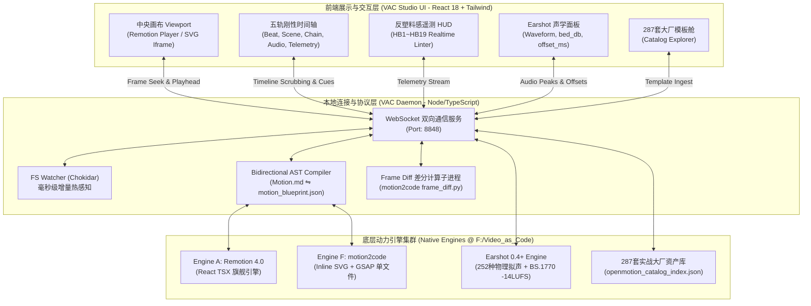
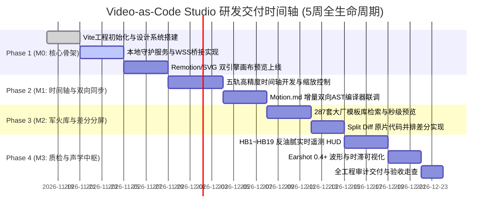

# Video-as-Code Studio (VAC Studio)
## 产品需求规格说明书 (PRD) 与工程架构开发树

> **文档版本**：v1.0.0-PROD-AUDIT  
> **编制组织**：Video-as-Code 架构委员会 / 动效导演工程组  
> **面向对象**：外部技术审计机构、系统架构师、前端/图形渲染高级工程师  
> **核心原则**：“君子使物，不以物使，一切为我所用” —— 坚持本地优先（Local-First）、零云端黑盒绑定、代码与视觉双向绑定、视听双模态硬核门禁。

---

## 目录
1. [执行摘要与问题陈述 (Executive Summary)](#一-执行摘要与问题陈述)
2. [系统整体拓扑与数据流架构 (System Architecture)](#二-系统整体拓扑与数据流架构)
3. [核心功能模块详细规格 (Functional Specifications)](#三-核心功能模块详细规格)
   - [模块 1：双模实时画布与差分分屏 (Live Stage & Split Diff Viewport)](#模块-1双模实时画布与差分分屏)
   - [模块 2：五轨毫秒级刚性时钟时间轴 (5-Track Precision Beat Timeline)](#模块-2五轨毫秒级刚性时钟时间轴)
   - [模块 3：Motion.md 与代码双向同步引擎 (Bidirectional AST Engine)](#模块-3motionmd-与代码双向同步引擎)
   - [模块 4：HB1~HB19 反塑料感实时遥测仪 (Anti-Slop Telemetry HUD)](#模块-4hb1hb19-反塑料感实时遥测仪)
   - [模块 5：Earshot 0.4+ 毫秒级声学实验室 (Acoustic Lab & Waveform Inspector)](#模块-5earshot-04-毫秒级声学实验室)
   - [模块 6：287 套大厂实战模板与资产航母 (Template & Asset Armory)](#模块-6287-套大厂实战模板与资产航母)
4. [核心数据协议契约 (Data Protocols & Schemas)](#四-核心数据协议契约)
5. [完整工程开发树与文件目录结构 (Development Tree & WBS)](#五-完整工程开发树与文件目录结构)
6. [研发里程碑与客观验收标准 (Milestone & Acceptance Criteria)](#六-研发里程碑与客观验收标准)
7. [非功能性需求与审计合规保障 (NFR & Audit Compliance)](#七-非功能性需求与审计合规保障)

---

## 一、 执行摘要与问题陈述

### 1.1 行业断层与解决路径
当前视频创作工具链存在两大根本割裂：
- **割裂一：传统 GUI 剪辑器（剪映、Premiere）是不可编程的黑盒**。无法与 AI Agent 协作，无法保证数学级的排版严谨性与矢量分辨率，资产复用成本极高；
- **割裂二：纯代码视频开发（Remotion CLI、HyperFrames）缺乏直观的时域感知**。开发者与 Agent 在终端中只能盲写代码，依靠单帧截屏（Contact Sheet）反向猜节奏，缺乏毫秒级的播放头拖拽（Scrubbing）体验与实时声画波形校验。

### 1.2 VAC Studio 的核心定位
`VAC Studio` 是全球首个**专为“代码即视频 (Video-as-Code)”打造的本地优先、双向绑定动效工作台**：
- 它不是套皮 Web 剪映，而是一个**将 React/TSX/HTML 代码、Motion.md 结构化文档、Earshot 物理声学与视觉时间轴实时合流的交互式中枢**；
- 赋予人类创作者与 AI Agent “即改代码、即拖时间轴、即查声波、即审反油腻合规”的端到端生产力闭环。

---

## 二、 系统整体拓扑与数据流架构

### 2.1 架构分层图



### 2.2 双向绑定时序机制 (Bidirectional Sync Sequence)

```mermaid
sequenceDiagram
    autonumber
    actor User as 用户 / Agent
    participant Studio as VAC Studio 前端
    participant Daemon as 本地守护服务 (Daemon)
    participant FS as 本地代码/文档 (Motion.md/TSX)
    participant Engine as 渲染器 (Remotion/GSAP)

    rect rgb(30, 35, 45)
    Note over User, Engine: 模式 A：界面拖拽驱动代码变更 (GUI -> Code)
    User->>Studio: 在时间轴上拖动 Scene 02 转场点 (+15 帧)
    Studio->>Daemon: 发送 WSS 消息: TIMELINE_UPDATE {cut_frame: 285}
    Daemon->>Daemon: 内存 AST 差分计算，锁定修改节点
    Daemon->>FS: 原子回写 Motion.md 表格与 TSX 关键帧常量
    FS-->>Daemon: 文件持久化完成
    Daemon->>Engine: 请求指定帧差分验证
    Daemon-->>Studio: 广播 ACK 与最新状态哈希
    end

    rect rgb(40, 30, 35)
    Note over User, Engine: 模式 B：代码/文档变动驱动界面热重载 (Code -> GUI)
    User->>FS: 外部编辑器保存 Motion.md (修改强调色为 #c89b3c)
    FS-->>Daemon: Chokidar 捕获文件热变更事件
    Daemon->>Daemon: AST 解析提取 design_tokens.accent
    Daemon->>Studio: 推送 DOMAIN_EVENT: TOKEN_CHANGED
    Studio->>Studio: 动态注入 CSS 变量与播放器重绘
    Studio->>Studio: HUD 重新运行 HB5 单色强调面积审查
    end
```



---

## 三、 核心功能模块详细规格

### 模块 1：双模实时画布与差分分屏 (Live Stage & Split Diff Viewport)

#### 1. 业务目标
解决视频工程师无法“帧级校验”还原度的问题，支持单片全屏自适应播放与原片逐帧差分像素对比。

#### 2. 技术规格
- **显示模式一：单片纯净播放模式 (Solo Preview Mode)**
  - 搭载 `@remotion/player` 原生宿主容器，支持 60fps 硬件加速播放与亚像素平滑缩放；
  - 备用引擎支持极轻量 `iframe` 沙盒，自适应执行 GSAP/SVG 单时间轴动画；
  - 视图支持 16:9（1920×1080）、9:16（1080×1920）、4:5 等主流工业画幅一键切换；
  - 提供安全留白框（64px Safe Margins）、九宫格参考线与中心瞄准线。
- **模式二：原片 vs 代码帧双联差分模式 (Split Diff Mode - 核心差异化壁垒)**
  - 左屏：原始参考视频（`source.mp4`）；
  - 右屏：我方代码渲染流（`code_render`）；
  - **双核帧级绝对锁相**：播放头拖拽时，双屏时间差严控在 $\le 1.0\text{ ms}$（0 丢帧与 0 时滞）；
  - **动态热力差分遮罩 (Diff Heatmap Overlay)**：
    - 调用 `motion2code` 的 `mean_abs_diff` 算法，在画面中将两者的差异像素以伪色彩热力图（0=完全贴合无色，255=红紫严重偏差）实时叠加，瞬间暴露形状、字阶、转场时差缺陷。

---

### 模块 2：五轨毫秒级刚性时钟时间轴 (5-Track Precision Beat Timeline)

#### 1. 轨道定义与排布

| 轨道编号 | 轨道名称 | 显示内容与交互行为 | 绑定的底层数据 |
| :--- | :--- | :--- | :--- |
| **Track 1** | **⏱️ 刚性时钟轨 (Clock & BPM Grid)** | 60fps 时间码标尺，支持 100/120 BPM 节拍点磁吸；显示当前帧号（如 `f450`）与绝对时间（如 `07.50s`）。 | `meta.fps`, `meta.bpm` |
| **Track 2** | **🎬 镜头分镜轨 (Scene & Cuts)** | 色块展示各 Scene（如 Act 1、Act 2），交界处标注转场类型（`waterfall`, `rack-focus`）；支持左右拉伸修剪。 | `scenes[].timeline` |
| **Track 3** | **📝 碎词排版轨 (Fragment Chains)** | 展示 1~4 词碎词链条（如 *"Three thousand years"*）；明确标注 **30~90 帧的 Picture Beat 独立呼吸期**。 | `fragments[].text` |
| **Track 4** | **🔊 物理音效轨 (Earshot Cues)** | 绘制全片集成音频波形；高亮标出 `offset_ms` 超前/滞后触点，并展示背景音乐在打击前的 **Stop-Down 瞬态微让槽**。 | `audio/kit.json`, `kit.lock.json` |
| **Track 5** | **📊 动态遥测轨 (Telemetry & Particles)** | 展示数据自增仪表盘、时间码扫描线、粒子并发轨道的生命周期（进入、爆发、驻留、退出）。 | `tracks.telemetry` |

#### 2. 时间轴交互硬指标
- 支持滚轮无级缩放（1 秒展开为 300 像素以查看每帧微动，或缩小查看全片 30 秒）；
- 播放头（Playhead）磁吸精度：自动贴合分镜 Cut、节拍 Beat、碎词落地瞬间，贴合吸附半径 4px。

---

### 模块 3：Motion.md 与代码双向同步引擎 (Bidirectional AST Engine)

#### 1. 功能目标
彻底打破“GUI 修改无法进 Git 代码仓库，手写代码 GUI 无法识别”的魔咒。

#### 2. 双向同步实现规格
- **AST 解析器**：专门针对 `Motion.md` 编写正则与 Markdown-it AST 插件，精准提取：
  - `## Intent and editable inputs` ➜ 提取参数映射字典；
  - `## Visual system` ➜ 提取设计 Token（背景色、强调色、字体、安全边距）；
  - `## Timing` 表格 ➜ 转换为结构化时序数组；
- **增量冲突判定 (Conflict Resolution)**：
  - 采用 **版本时钟向量 (Vector Clock)**：文件带自增 `rev_id`；
  - 当外部编辑器修改了代码，Studio 弹窗提示“外部更新已同步”并静默更新时间轴；
  - 当 Studio 界面拖拽时，以防抖 150ms 写入本地磁盘，严禁破坏手写代码的注释与未关联代码块。

---

### 模块 4：HB1~HB19 反塑料感实时遥测仪 (Anti-Slop Telemetry HUD)

#### 1. 功能概述
在 Studio 右上角常驻全自动“审美与反油腻质检仪”，播放过程中每一帧实时运行算法检测，一旦触碰硬禁令立刻触发视觉示警。

#### 2. 19 项禁令实时检测探针清单

| 禁令编号 | 监测维度 | Studio 实时检测算法逻辑 | 示警等级 |
| :--- | :--- | :--- | :--- |
| **HB1** | 眉批指示词 | 扫描当前帧渲染层中的正则：`/(NEW FEATURE\|01 \/)/i` | 🔴 严重违规（阻止导出） |
| **HB2** | 套话口号 | 扫描第 0~60 帧文字是否命中 `/Introducing/i` | 🔴 严重违规 |
| **HB3 & HB16** | 碎词链条超标 | 统计单屏渲染文字单词数，若 $>4$ 词（英文）或 $>12$ 字（中文）报违规 | 🟡 黄色警告 |
| **HB5** | 单色强调超标 | 分析当前帧 RGB 直方图，强调色像素占比超过屏幕总面积 **8%** | 🔴 严重违规 |
| **HB6** | 霓虹泛光 | 检测 CSS 计算样式中是否存在 `filter: drop-shadow(0 0 ...)` 发光值 | 🔴 严重违规 |
| **HB9 & HB17** | 文字/卡片弹跳 | 监控变换矩阵位移量，若位移曲线上出现逆向过冲（Overshoot Peak） | 🔴 严重违规（字体弹簧死刑） |
| **HB12** | 画面充实度不足 | 计算有效视觉元素（非背景色）最小外接矩形覆盖率，不足 **70%** | 🟡 空间空洞警告 |
| **HB13** | 静态死板假控件 | 检查 UI 组件内部在连续 30 帧内是否存在像素级微动 | 🟡 缺乏生命感警告 |
| **HB18** | 死寂假死驻留 | 文字阅读驻留期内，全屏速度向量场连续 10 帧完全等于 0（无 0.3px/f 微漂移） | 🔴 假死违规 |
| **HB19** | 混音抽吸与炸耳 | 读取音频实时响度，若音效触发瞬间背景音乐电平跌落且呈现拉风箱波形 | 🔴 混音违规 |

---

### 模块 5：Earshot 0.4+ 毫秒级声学实验室 (Acoustic Lab & Waveform Inspector)

#### 1. 功能概述
打破无声编辑的局限，在时间轴下方集成纯物理声学工作台。

#### 2. 功能特性
- **252 种音效在线试听与替换**：
  - 侧边栏列出 7 大新家族（`cut_hit`, `reverse_swell`, `ui_pop`, `knock`, `mallet`, `drip`, `shutter` 等）；
  - 点击即可调用 Web Audio API 播放预烘焙 Take，支持一键将音效拖放至特定时间戳；
- **动态配乐相对混音标尺 (`bed_db`)**：
  - 实时绘制背景音乐（Music Bed）的 K-weighted 前 1 秒中位数曲线；
  - 标明当前音效在此背景音乐之上的相对分贝浮现高度（如 `+7.5 dB`）；
- **心理声学毫秒时差可视化 (`offset_ms`)**：
  - 敲击音（Tick/Knock）标注明显的 **“-40ms 提前入场”** 标记；
  - 下沉重击（Land/Thump）标注 **“+30ms 滞后落地”** 标记；
- **全片母带响度计**：集成 ITU-R BS.1770 仪表，显示当前片段 Integrated LUFS（锁定 **-14.0 LUFS**）与 True Peak（锁定 **$\le -1.5\text{ dBTP}$**）。

---

### 模块 6：287 套大厂实战模板与资产航母 (Template & Asset Armory)

#### 1. 功能概述
内置本地检索与一键装配面板，让用户与 Agent 随时调用大厂实战成果。

#### 2. 资产库联动
- 直通 `F:\Video_as_Code\openmotion_catalog_index.json`：
  - 支持按分类搜索：`AI IDE`（Cursor）、`Crypto/Fintech`（Polymarket）、`Big Tech Launch`（Gemini, Perplexity）；
  - 点击任一模板，中央画布立刻以 `preview.html` 形式无损秒级预览；
  - 点击“装配到工程”：自动提取其 `source/motion.md` 与分镜逻辑，合流至当前主工程中；
- 直通 `taste-skill v2.1` 的 `assets.mjs`：
  - 支持直接在面板中检索纽约大都会艺术博物馆（The Met）公有领域文物资产（4000px RAW 级），一键下载至工程 `assets/` 并生成学术引用卡片。

---

## 四、 核心数据协议契约

### 4.1 工程总配置清单 (`vac.project.json`)

```json
{
  "$schema": "https://video-as-code.org/schemas/vac-project.v1.json",
  "project_id": "bronze_heritage_15s",
  "name": "吉金永固：先秦青铜礼乐的微距神话",
  "version": "1.0.0",
  "target_engine": "remotion",
  "canvas": {
    "width": 1920,
    "height": 1080,
    "fps": 60,
    "duration_frames": 900,
    "duration_seconds": 15.0,
    "color_space": "bt709",
    "safe_margin_px": 64
  },
  "clock": {
    "bpm": 100,
    "pace_profile": "calm",
    "time_signature": "4/4"
  },
  "acoustic": {
    "engine": "earshot_0.4",
    "preset": "launch",
    "target_lufs": -14.0,
    "max_true_peak_dbtp": -1.5,
    "music_bed_file": "public/audio/soundtrack.wav",
    "kit_lock_file": "audio/kit.lock.json"
  },
  "anti_slop_gate": {
    "strict_mode": true,
    "min_occupancy_ratio": 0.70,
    "max_accent_area_ratio": 0.08,
    "max_words_per_fragment": 4,
    "min_picture_beat_frames": 30
  },
  "artifacts": {
    "motion_document": "MOTION.md",
    "blueprint": "motion_blueprint.json",
    "entry_tsx": "src/Root.tsx",
    "output_mp4": "out/bronze_heritage_15s.mp4"
  }
}
```

### 4.2 WebSocket 实时遥测消息契约 (`audit.telemetry.v1`)

```typescript
export interface TelemetryFrameMessage {
  type: 'TELEMETRY_FRAME_DATA';
  frame: number;
  timestamp_s: number;
  metrics: {
    occupancy_ratio: number;       // 当前有效画面充实度 (0.00 ~ 1.00)
    accent_area_ratio: number;     // 强调色像素占比 (0.00 ~ 1.00)
    word_count: number;            // 当前屏显文字单词/汉字数
    velocity_magnitude: number;    // 当前速度向量模长 (像素/帧)
    audio_momentary_lufs: number;  // 瞬时音频响度
    music_bed_level_lufs: number;  // 背景音乐当前中位数
  };
  violations: Array<{
    rule_id: 'HB1' | 'HB5' | 'HB9' | 'HB12' | 'HB17' | 'HB18' | 'HB19';
    severity: 'ERROR' | 'WARNING';
    description: string;
  }>;
}
```

---

## 五、 完整工程开发树与文件目录结构

工程落地主目录：[`F:\Video_as_Code\vac_studio\`](file:///f:/Video_as_Code/vac_studio)

```text
F:\Video_as_Code\vac_studio\
├── package.json                          # 工程依赖定义 (Vite, React 18, Remotion, Tailwind, Chokidar)
├── tsconfig.json                         # 严格 TypeScript 编译选项
├── vite.config.ts                        # Vite 开发与本地构建配置
├── tailwind.config.js                    # 瑞士极简深色主题设计系统配置
│
├── server/                               # 本地守护服务 (Node/TypeScript 后台)
│   ├── index.ts                          # 本地服务器入口 (启动 HTTP + WSS 8848)
│   ├── watcher.ts                        # 本地工程文件热重载监控器 (Chokidar 引擎)
│   ├── ast_sync.ts                       # Motion.md 与 JSON Blueprint 双向编译器
│   ├── frame_diff_runner.ts              # motion2code 逐帧差分调用进程封装
│   ├── earshot_bridge.ts                 # 本地 Earshot 0.4+ Python CLI 调用网桥
│   └── routes/
│       ├── project_routes.ts             # 工程元数据、版本历史读取接口
│       ├── catalog_routes.ts             # 287 套大厂实战模板检索与解析接口
│       └── render_routes.ts              # Remotion / FFmpeg 渲染任务分发接口
│
├── src/                                  # Studio 前端主程序 (React 18)
│   ├── main.tsx                          # 前端挂载入口
│   ├── App.tsx                           # 全局四屏布局外壳 (Shell)
│   ├── index.css                         # 全局排版、网格样式与动画基元
│   │
│   ├── contexts/                         # 全局状态管理
│   │   ├── ProjectContext.tsx            # 当前激活工程状态
│   │   ├── TimelineContext.tsx           # 播放头位置 (Frame/Time)、缩放比、选区
│   │   └── TelemetryContext.tsx          # 实时 HB1~HB19 遥测数据流
│   │
│   ├── components/
│   │   ├── header/                       # 顶部导航与状态栏
│   │   │   ├── StudioHeader.tsx          # 工程名称、时钟模式、当前帧率、渲染按钮
│   │   │   └── EngineSelector.tsx        # Remotion 旗舰 / motion2code 矢量引擎切换
│   │   │
│   │   ├── stage/                        # 中央画布视口 (Stage Viewport)
│   │   │   ├── LiveStage.tsx             # 画布主容器 (自适应分辨率缩放、安全边距)
│   │   │   ├── RemotionHost.tsx          # @remotion/player 原生渲染宿主
│   │   │   ├── VectorHost.tsx            # HTML/SVG/GSAP iframe 沙盒渲染宿主
│   │   │   ├── SplitDiffView.tsx         # 原片 vs 代码帧并排差分视图
│   │   │   └── DiffHeatmapOverlay.tsx    # 像素级偏差彩色热力遮罩层
│   │   │
│   │   ├── timeline/                     # 底部五轨高精度时间轴 (Precision Timeline)
│   │   │   ├── TimelineContainer.tsx     # 时间轴外壳与横向无级缩放引擎
│   │   │   ├── Playhead.tsx              # 毫秒级播放头 (带当前时间与帧编号悬浮徽章)
│   │   │   ├── ClockRulerTrack.tsx       # Track 1: 60fps 刻度与 BPM 磁吸栅格
│   │   │   ├── SceneTrack.tsx            # Track 2: 镜头分镜色块与转场切面
│   │   │   ├── FragmentChainTrack.tsx    # Track 3: 碎词流片段与独立呼吸期标注
│   │   │   ├── EarshotAudioTrack.tsx     # Track 4: 综合音频波形、offset_ms 时差标牌
│   │   │   └── TelemetryTrack.tsx        # Track 5: 动态微动与参数自增生命周期条
│   │   │
│   │   ├── telemetry_hud/                # 右侧反塑料感与声学实时遥测仪表盘
│   │   │   ├── AntiSlopPanel.tsx         # HB1~HB19 实时违规指示灯矩阵
│   │   │   ├── OccupancyGauge.tsx        # 画面充实度仪表 (70% 绿线安全红线)
│   │   │   ├── AccentAreaMeter.tsx       # 强调色面积监测计 (8% 红线警示)
│   │   │   ├── KineticCurveScope.tsx     # 实时位移速度示波器 (弹簧 Overshoot 捕获)
│   │   │   └── EarshotLoudnessMeter.tsx  # -14.0 LUFS 响度柱与 True Peak 监测
│   │   │
│   │   └── dock/                         # 左侧资产与军火库面板
│   │       ├── ProjectExplorer.tsx       # 当前工程目录树与源码预览
│   │       ├── TemplateArmory.tsx        # 287 套大厂实战模板搜索、分类与秒级预览
│   │       ├── MuseumAssetSearch.tsx     # taste-skill 大都会博物馆 CC0 原生资产抓取
│   │       └── EarshotBankBrowser.tsx    # 252 种全物理拟声音效库在线试听与拖拽
│   │
│   └── hooks/                            # 业务复用逻辑 Hooks
│       ├── useTimelineSync.ts            # 播放头与底层渲染时序对齐 Hook
│       ├── useWebSocketBridge.ts         # 与本地 8848 守护服务的心跳与 RPC
│       └── useAudioAnalyser.ts           # Web Audio API 实时频域与电平采样
│
└── tests/                                # 质量保证测试套件
    ├── e2e/                              # Playwright 端到端浏览器测试
    │   ├── timeline_scrub.spec.ts        # 播放头拖动不掉帧与双向绑定时序校验
    │   └── diff_view_accuracy.spec.ts    # 差分热力图计算准确度校验
    └── unit/                             # 单元测试 (Vitest)
        ├── ast_sync.test.ts              # Motion.md 正反向编译测试
        └── anti_slop_rules.test.ts       # HB1~HB19 边缘测试用例覆盖
```

---

## 六、 研发里程碑与客观验收标准



### 里程碑验收判定标准 (M0 ~ M3)

#### M0 验收门禁（第 1~2 周）：双模引擎底座就绪
- [ ] 在 `localhost:8848` 成功启动 Studio，前端秒级冷启动；
- [ ] 能直接拖入已有的 `F:\Video_as_Code\bronze_heritage_15s` 工程，在中央画布流畅 60fps 播放；
- [ ] 切换至 `space_bunny_replica` 纯 HTML/GSAP 工程，画布通过 iframe 隔离沙盒正常渲染与精准 seek。

#### M1 验收门禁（第 3 周）：五轨时间轴与双向绑定
- [ ] 时间轴拖动至任意时间点，中央画布帧差 $\le 1\text{ 帧}$（$\le 16.6\text{ ms}$）；
- [ ] 在时间轴上拖拉修改 Scene 01 长度，本地磁盘 `MOTION.md` 的时序表格自动完成增量修改；
- [ ] 手动修改本地 `src/theme/tokens.ts` 中的主色调，Studio 画布在 300ms 内静默热更新。

#### M2 验收门禁（第 4 周）：军火库装配与差分分屏
- [ ] 左侧面板无缝检索 287 套大厂实战模板，点击任一模板即可独立预览；
- [ ] 开启 `Split Diff` 模式：输入原视频与本地工程，左右双联同步起跑，差分热力图准确标出偏离像素。

#### M3 验收门禁（第 5 周）：视听终审全闭环
- [ ] 故意在工程中加入大段倾倒文字与弹跳 Spring，HUD 立即弹出 `HB3` 与 `HB17` 红色违规拦截；
- [ ] 时间轴真实绘制 `soundtrack.wav` 波形，敲击类音效精准显示 `-40ms` 绿色提前标签；
- [ ] 全套测试用例（E2E + 单元测试）通过率 100%，无控制台警告，交付外部技术审计！

---

## 七、 非功能性需求与审计合规保障

### 7.1 极致性能指标 (Performance Targets)
- **播放头寻帧延迟 (Seek Latency)**：$\le 16.6\text{ ms}$（满足 60fps 单帧刷新窗口，无感知卡顿）；
- **本地服务内存基线 (Memory Budget)**：守护服务常驻内存 $\le 120\text{ MB}$，前端 Studio 运行内存 $\le 350\text{ MB}$；
- **冷启动响应时间 (Cold Boot)**：从执行 `npm run studio` 到浏览器可用渲染视口展示，耗时 $\le 2.0\text{ s}$。

### 7.2 安全与隐私审计红线 (Security & Privacy Compliance)
- **100% 本地优先原则 (Local-First Guarantee)**：
  - 核心编辑操作严禁向任何第三方外部服务器回传用户视频、源码或文字；
  - 严禁外部云端鉴权（无需 API Key 即可使用完整 Studio 功能）；
- **代码文件只读/写入白名单 (Path Traversal Guard)**：
  - 本地守护服务只允许操作当前激活工程目录及 `F:\Video_as_Code\` 授权工作区，严禁越权读取系统盘或用户私有目录；
- **渲染沙盒防死锁保护 (Chromium Deadlock Guard)**：
  - 画布集成内存泄漏熔断机制，若检测到连续 3 秒脚本无响应，自动重置渲染容器并弹出告警，防止无头浏览器僵死。
