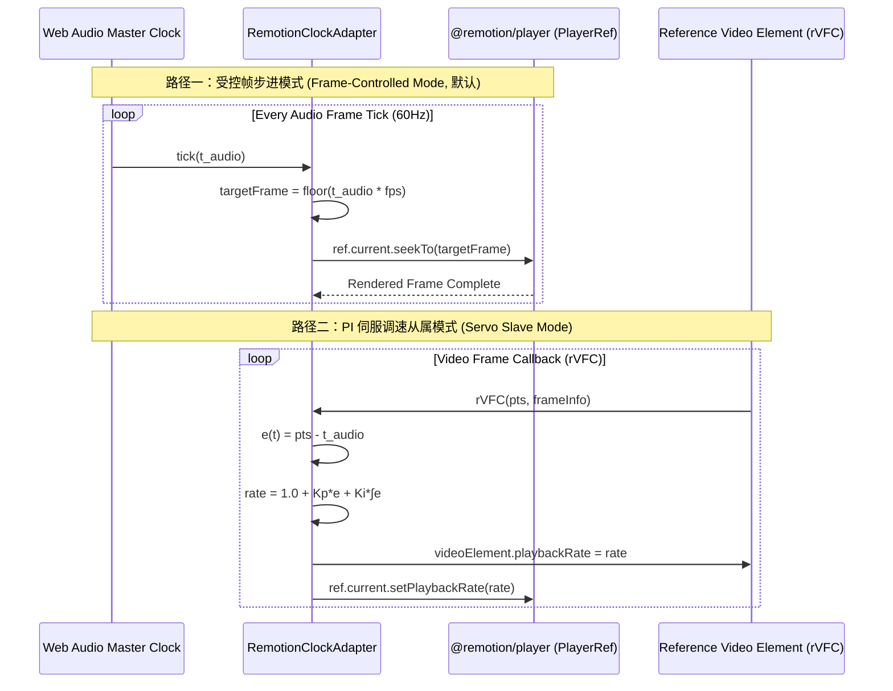
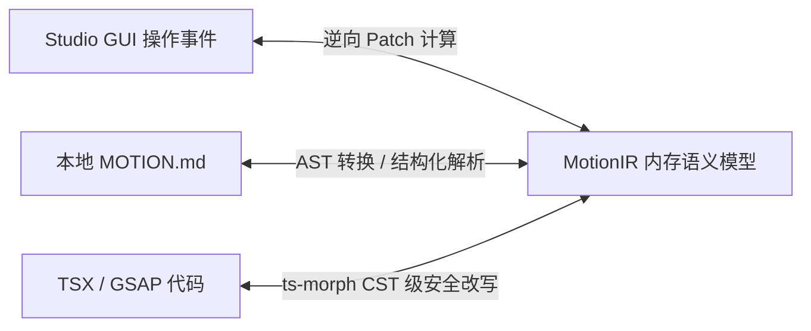
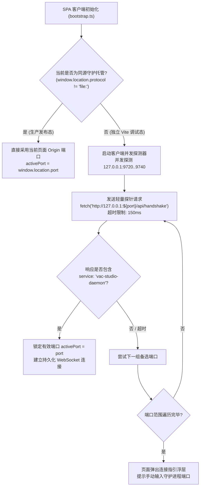

# Video-as-Code Studio (VAC Studio)
# 软件需求规格说明书 (PRD) 与系统技术架构方案
## 版本：v2.1.0-AUDIT-SUBMISSION

> **文档密级**：技术架构方案 / 外部审计评审正本  
> **编制组织**：Video-as-Code 架构委员会 / 动效导演工程组  
> **文档标准**：遵循 ISO/IEC/IEEE 29148:2018 软件工程需求规格规范  
> **核验目标**：针对外部审计第 1、第 2 轮审查意见完成全面工程闭环，涵盖双流精准同步时钟接管路径、网络端口防死循环探测机制、MotionIR 双向 AST 治理架构及完整 13 组 Given-When-Then 验收测试矩阵。

---

## 目录
- [0. 核心术语与物理概念定义 (Glossary)](#0-核心术语与物理概念定义-glossary)
- [1. 系统技术架构与非功能性约束 (System Architecture)](#1-系统技术架构与非功能性约束-system-architecture)
- [2. 双流精确帧同步与差分测量机制 (Dual-Stream Sync & Measurement)](#2-双流精确帧同步与差分测量机制-dual-stream-sync--measurement)
- [3. 双向 AST 同步引擎与 MotionIR 语义中间层设计 (MotionIR & AST Engine)](#3-双向-ast-同步引擎与-motionir-语义中间层设计-motionir--ast-engine)
- [4. 网络通信、守护进程与端口容灾设计 (Network & Port Management)](#4-网络通信守护进程与端口容灾设计-network--port-management)
- [5. 数据协议与接口契约规范 (Data Protocols & Interface Contracts)](#5-数据协议与接口契约规范-data-protocols--interface-contracts)
- [6. 工程风险登记册与防御策略 (Risk Registry & Mitigations)](#6-工程风险登记册与防御策略-risk-registry--mitigations)
- [7. M1 阶段任务级工作分解结构与工期估算 (M1 Task-Level WBS)](#7-m1-阶段任务级工作分解结构与工期估算-m1-task-level-wbs)
- [8. 客观验收准则与测试用例矩阵 (Given-When-Then Acceptance Criteria)](#8-客观验收准则与测试用例矩阵-given-when-then-acceptance-criteria)

---

## 0. 核心术语与物理概念定义 (Glossary)

本章节定义本系统研发与质量审计所依赖的专业术语、声学物理量及工程缩略语：

| 术语名称 | 英文标识 | 工业界/学术界对应标准与工程定义 |
| :--- | :--- | :--- |
| **违规特征禁令** | **HB1 ~ HB19 (Hard Bans)** | 系统预设的 19 项违背现代工业级动效设计法则的量化违规指标（包含 HB1 假眉批、HB5 强调色面积超限 8%、HB9/HB17 文本图层弹簧反向过冲、HB12 画面整体充实度低于 70%、HB18 连续 30 帧绝对静态驻留、HB19 全局侧链抽吸）。违反任一项指标将触发构建门禁拦截。 |
| **心理声学时滞** | **Psychoacoustic Offset (`offset_ms`)** | 人脑视听中枢对光与声音的处理延迟差（视觉感知延迟约 50~80ms，触觉与突发声感知延迟约 10~20ms）。系统在敲击类动作上强制设置 **-11ms ~ -60ms 的超前入场**，在重物落地动量上设置 **+30ms ~ +42ms 的滞后下潜**，模拟真实物理惯性。 |
| **瞬态避让槽** | **Stop-Down Notch** | 针对高动态配乐发布片，用于替代全局侧链压限（Sidechain Ducking）引发的低频底噪抽吸现象。系统在核心音效触发前 0.3s~0.5s 使背景音乐平滑衰减 6~12dB，在击打落点瞬间瞬态恢复原电平的局部混音机制。 |
| **分段碎词流** | **Fragment Chains** | 文本排版协议：单行文本严格限制为 1~4 个英文单词或 4~12 个汉字，采用 `build`（叠行增量）或 `replace`（整行拔起）推进，杜绝段落倾倒（Sentence Dump）。 |
| **画面呼吸期** | **Picture Beat (30~90f)** | 碎词链条推进过程中的静默视觉窗口。文字片段落地后，保留 30~90 帧（0.5~1.5s）供画面核心主体执行主动动作，在此期间文字保持微漂移，禁止画面高速运动与文字入场重叠。 |
| **贯穿信物** | **Carrier Object** | 动力学守恒载体。场景转场过渡期持续存在、不被销毁的视觉锚点元素（如游标、焦点框、品牌标识），引导受众视觉注意焦点穿透转场割裂。 |
| **鲜活驻留** | **Living Holds** | 在文本阅读停留窗口期，画面元素保持 0.3~1.0 px/frame 缓慢微移或 1%~3% 摄像机景深推拉，避免触发视觉假死（HB18）。 |
| **物理声学引擎** | **Earshot 0.4+** | 基于物理声学方程建模（Modal Resonators, Air Turbulence, Contact Friction）的 252 种全代码合成拟声系统，输出电平严格遵循 ITU-R BS.1770-4 -14.0 LUFS 响度标准。 |
| **动效中间表示** | **MotionIR** | 系统内部用于解耦 GUI 操作、Markdown 规格文件与 React/GSAP AST 抽象语法树的中立强类型数据模型。 |

---

## 1. 系统技术架构与非功能性约束 (System Architecture)

### 1.1 架构拓扑
系统采用**本地原生守护进程 (Local Native Daemon) + 本地 Web 客户端 (SPA)** 分离架构，所有数据交换运行于本地回环网络（127.0.0.1），不依赖任何外部公网连接。

```mermaid
graph TD
    subgraph Client["VAC Studio Client (Vite + React 18 + Web Audio API)"]
        Viewport["双模画布 (Remotion Host / WebCodecs Diff)"]
        TimelineCore["五轨刚性时间轴 (Web Audio Master Clock)"]
        HUD["Anti-Slop HB1~HB19 实时遥测分析仪"]
        CatalogView["287套大厂实战模板与资产舱"]
        ClientBootstrap["端口自适应探测器 (Sequential/Concurrent Prober)"]
    end

    subgraph Daemon["Local Native Daemon (Node.js 22 LTS / TS)"]
        Router["HTTP / WebSocket 路由分发 (Default: 9720)"]
        PortProber["端口自动碰撞探测与回退引擎"]
        AST_Engine["MotionIR ⇋ AST 双向编译器 (ts-morph / Babel)"]
        Diff_Daemon["WebCodecs / FFmpeg 原片帧流解码引擎"]
        Earshot_Bridge["Earshot 0.4 Python 本地运行时网桥"]
    end

    subgraph Disk["本地磁盘资产 (F:/Video_as_Code/)"]
        SourceCode["TSX / HTML 动效源码"]
        DocMarkdown["MOTION.md 设计契约"]
        SoundBank["Earshot 252 种物理音频库"]
        CatalogData["287 套大厂实战模板库"]
    end

    ClientBootstrap -->|HTTP Handshake 探针 (9720..9740)| Router
    Viewport <-->|WSS: 实时 Seek 指令 & 差分帧| Router
    TimelineCore <-->|WSS: 播放头同步 & Cues 变动| Router
    HUD <-->|WSS: 违规检测遥测数据流| Router
    CatalogView <-->|HTTP: 模板加载与解析请求| Router

    Router <--> PortProber
    Router <--> AST_Engine
    Router <--> Diff_Daemon
    Router <--> Earshot_Bridge

    AST_Engine <-->|双向原子读写| SourceCode
    AST_Engine <-->|双向同步| DocMarkdown
    Earshot_Bridge <--> SoundBank
    Router <--> CatalogData
```

### 1.2 非功能性技术指标
1. **渲染帧率**：视口渲染支持 60fps 恒定帧率（CFR），UI 交互主线程长任务持续时间 $\le 50\text{ ms}$；
2. **时钟抖动**：实时播放状态下，声画同步物理时滞绝对值 $|\Delta t| < 8.0\text{ ms}$；逐帧擦洗比对状态下 $\Delta t = 0.0\text{ ms}$；
3. **AST 回写性能**：GUI 时间轴拖拽触发的代码 AST 解析、Patch 与落盘耗时 $\le 50\text{ ms}$（单文件行数 $\le 1500$ 行）；
4. **内存开销**：客户端长期驻留内存 $\le 512\text{ MB}$，守护进程内存 $\le 256\text{ MB}$；
5. **本地优先**：零云端 API 依赖，断网环境下 100% 核心功能可用。

---

## 2. 双流精确帧同步与差分测量机制 (Dual-Stream Sync & Measurement)

### 2.1 运行模式解耦设计
为规避通用浏览器 `requestAnimationFrame` 离散刷新（16.67ms/帧）带来的时间戳漂移，系统将运行时解耦为两种工作模式：

```
                    ┌───────────────────────────────┐
                    │  VAC Studio 时间驱动模式解耦  │
                    └───────────────┬───────────────┘
                                    │
            ┌───────────────────────┴───────────────────────┐
            ▼                                               ▼
┌───────────────────────────────┐               ┌───────────────────────────────┐
│ 模式 A: 实时播放预览 (Playback)│               │ 模式 B: 拖拽/暂停比对 (Scrub) │
├───────────────────────────────┤               ├───────────────────────────────┤
│ • 主时钟: Web Audio 硬件晶振  │               │ • 主时钟: 离散帧索引 (Frame N)│
│ • 机制: PI 伺服锁相环频差补偿 │               │ • 机制: WebCodecs 确定性解码  │
│ • 指标: 帧错位 Δframe = 0     │               │ • 指标: 物理时间差 Δt = 0.0ms │
│   物理时滞漂移 |Δt| < 8.0ms   │               │   像素重合误差 0 丢帧 0 抖动  │
└───────────────────────────────┘               └───────────────────────────────┘
```

### 2.2 模式 A：实时播放模式与 Remotion Player 时钟接管集成路径

#### 2.2.1 硬件主时钟选型与 PLL 闭环算法
- 采用 Web Audio API 的 `AudioContext.currentTime` 作为唯一全局主时钟源（由声卡底层硬件晶振驱动，具备微秒级时间精度，不受 DOM 渲染与 JS 事件循环排队影响）。
- **零点基线相对校准规范**：
  播放启动瞬间捕获基准绝对时钟 $t_{\text{base}} = \text{audioCtx.currentTime}$，后续相对音频主时钟严格执行相对零点偏移与非负钳制：
  $$t_{\text{audio}}(k) = \max\left(0.0, \, \text{audioCtx.currentTime} - t_{\text{base}}\right)$$
  首帧 $k=0$ 强制绝对锚定于 $0.000000\text{ s}$，杜绝因硬件时钟启动抖动产生负时间戳。
- 建立主从锁相环（PLL）闭环伺服系统：
  1. **代码流驱动**：代码渲染视口（Remotion）根据主时钟实时计算目标帧号：
     $$F(t) = \text{round}(t_{\text{audio}} \times \text{fps})$$
  2. **参考视频流采样**：通过 HTML5 `<video>` 的 `requestVideoFrameCallback` (rVFC) 接口获取参考原片实际送显时间戳 $t_{\text{video\_display\_s}}$（即 `metadata.mediaTime`，精确反映合成器送显时间切片）；
  3. **瞬时相位误差计算**：
     $$e(t) = t_{\text{video\_display\_s}} - t_{\text{audio\_s}}$$
  4. **比例-积分 (PI) 伺服调速算法与负反馈控制律**：
     $$v_{\text{video}}(t) = 1.0 - K_p \cdot e(t) - K_i \int_0^t e(\tau) d\tau$$
     式中参数按误差量纲（秒）进行物理标准化：$K_p = 6.0\text{ s}^{-1}, K_i = 0.8\text{ s}^{-2}$，积分项设抗饱和钳制边界 $[-0.02\text{ s}, 0.02\text{ s}]$。
     控制律严格遵循负反馈物理方向：当参考视频超前（$e(t) > 0$）时调低播放倍率减速（$v < 1.0$）；当滞后（$e(t) < 0$）时调高倍率加速（$v > 1.0$）。
     瞬时播放倍率被平滑钳制在 $[0.9500, 1.0500]$ 物理边界内；若异常出现 $|e(t)| > 16.6\text{ ms}$（大于 1 帧）时触发微跳步硬同步（Hard Saccade Seek）。

#### 2.2.2 Remotion Player 内部时钟接管工程路径
针对 `@remotion/player` 默认基于 `performance.now()` 自运行渲染循环的问题，系统采用两种明确的接管路径：



**工程实现契约**：
1. **受控帧步进模式（默认精准模式）**：
   ```tsx
   // Client 代码集成路径: src/components/stage/RemotionHost.tsx
   import { Player, PlayerRef } from '@remotion/player';
   import { useRef, useEffect } from 'react';
   import { masterClock } from '@/audio/master_clock';

   export const RemotionHost = ({ component: RootComponent, durationInFrames, fps = 60 }) => {
     const playerRef = useRef<PlayerRef>(null);

     useEffect(() => {
       if (!playerRef.current) return;
       // 架构关键纠偏：严禁将 60Hz 高频时钟放入 React 状态流 (useState)
       // 否则每秒 60 次重渲染将消耗主线程，且 useEffect 落在 Paint 之后执行天然滞后一帧。
       // 正确路径：通过 ref 挂载直接订阅底层 Web Audio 硬件时钟发布事件，
       // 在命令式回调中以零 React 渲染开销直接驱动 playerRef.current.seekTo(targetFrame)。
       const unsubscribe = masterClock.subscribe((t_audio) => {
         const targetFrame = Math.min(Math.floor(t_audio * fps), durationInFrames - 1);
         if (playerRef.current && playerRef.current.getCurrentFrame() !== targetFrame) {
           playerRef.current.seekTo(targetFrame);
         }
       });
       return () => unsubscribe();
     }, [fps, durationInFrames]);

     return (
       <Player
         ref={playerRef}
         component={RootComponent}
         durationInFrames={durationInFrames}
         compositionWidth={1920}
         compositionHeight={1080}
         fps={fps}
         controls={false}
         loop={false}
         // 禁用 Remotion 自主时钟，将其转换为纯受控帧级响应器
         style={{ width: '100%', height: '100%' }}
       />
     );
   };
   ```
2. **伺服从属模式（针对重度 3D / Shader 复杂计算场景）**：
   当页面渲染负载过重导致 `seekTo` 产生回退时，通过 `playerRef.current.setPlaybackRate(v_audio)` 同步接管 Remotion Player 内部调速通道，保持与音频上下文一致的倍率偏移。

### 2.3 模式 B：逐帧拖拽与差分模式 (Scrub & Diff Mode)
- 用户拖动时间轴（Scrubbing）或触发暂停时，系统切换为离散整数帧索引 $N \in [0, \text{TotalFrames}-1]$；
- **参考视频解码**：废弃 HTML5 `<video>`，改用浏览器底层 **WebCodecs API (`VideoDecoder`)**。守护进程预先将原片 demux 为独立的 GOP 索引，WebCodecs 在 Web Worker 中按需解码指定帧，直接向 OffscreenCanvas 投递 `VideoFrame`；
- **代码流渲染**：通过 `playerRef.current.seekTo(N)` 输出静态图像切片；
- **指标**：暂停与比对工况下，两流时间差**恒定满足 $\Delta t = 0.00\text{ ms}$**，杜绝 B 帧预测时差。

### 2.4 差分测量计算与热力图协议
系统差分模块输出量化数据与热力图指标：
1. 原片采样矩阵 $I_{\text{ref}}(x,y)$ 与代码渲染矩阵 $I_{\text{code}}(x,y)$ 统一标准化为 $1920 \times 1080 \times 3$ RGB 数组；
2. 逐像素欧氏差值：
   $$D(x,y) = \frac{1}{3} \sum_{c \in \{R,G,B\}} |I_{\text{ref}}(x,y,c) - I_{\text{code}}(x,y,c)|$$
3. 全帧平均差分标量：
   $$\bar{D} = \frac{1}{W \times H} \sum_{x=0}^{W-1} \sum_{y=0}^{H-1} D(x,y) \in [0, 255]$$
4. 伪彩色着色规则：
   - 若 $D(x,y) \le 5$，RGBA 赋值为 $(0, 0, 0, 0)$（全透明）；
   - 若 $D(x,y) > 15$，采用 Turbo 伪彩色映射为高亮红紫色覆层，标示几何形变或位移偏差点。

---

## 3. 双向 AST 同步引擎与 MotionIR 语义中间层设计 (MotionIR & AST Engine)

### 3.1 语义中枢架构
为阻断 GUI 操作与底层 AST 之间的强耦合，系统引入标准化的强类型数据模型 **MotionIR** 作为唯一中转层：



### 3.2 MotionIR 数据模型规范
```typescript
export interface MotionIR {
  version: '2.1.0';
  meta: {
    projectId: string;
    fps: 60;
    bpm: number;
    totalDurationFrames: number;
  };
  designTokens: {
    groundColor: string;       // 背景基底色 (十六进制)
    accentColor: string;       // 核心强调色 (面积受 HB5 8% 约束)
    fontDisplay: string;       // 标题排版字体
    fontMono: string;          // 动态数据等宽字体
  };
  tracks: {
    scenes: Array<{
      id: string;              // 场景标识 (如 scene-01)
      sourceFile: string;      // 源码物理相对路径 (如 src/acts/Act1.tsx)
      startFrame: number;
      durationFrames: number;
      transitionIn?: {
        type: 'waterfall' | 'rack_focus' | 'zoom_through';
        durationFrames: number;
      };
      ownership: 'MANAGED_DECLARATIVE' | 'OPAQUE_USER_CODE';
    }>;
    fragments: Array<{
      id: string;
      text: string;
      sceneId: string;
      startFrame: number;
      holdFrames: number;
      wordCount: number;       // 单词计数，受碎词流规则校验
    }>;
    audioCues: Array<{
      id: string;
      soundId: string;         // 对应 Earshot 252 资产库唯一标识
      triggerFrame: number;
      offsetMs: number;        // 心理声学时滞偏置 (-60ms ~ +42ms)
      bedDb: number;           // 背景声避让基线分贝
    }>;
  };
}
```

### 3.3 代码所有权分区与保真保护机制

#### 3.3.1 托管声明区 (Managed Declarative Zone, MDZ)
- 仅当代码节点位于显式 `@vac:managed` 标注块内或符合结构化元数据模式时，AST 引擎才具备写入权限；
- 语法规范示例：
  ```tsx
  // @vac:managed:scene-01:start
  <Sequence from={0} durationInFrames={270} name="Scene01">
    <Act1 enterPace={PACE.calm} />
  </Sequence>
  // @vac:managed:scene-01:end
  ```

#### 3.3.2 非托管代码区 (Opaque User-Code Zone, UZ)
- 包含自定义 React Hooks、状态订阅、外部三方库逻辑、Canvas 绘制代码等；
- **CST 级保真规则**：AST 改写器基于 `ts-morph` 构建。遇到未标注区域时，严格保留原始语法标记、缩进、行尾注释与空格（Concrete Syntax Tree 级保护），禁止全局执行 Prettier 格式化污染，仅对 MDZ 目标节点实施局部属性替换。

### 3.4 动态与不可解析表达式的降级策略

```
[ 用户在代码中将静态值 durationInFrames={270} 修改为 durationInFrames={computePacing()} ]
                                      │
                                      ▼
             [ ts-morph 进行节点类型静态求值分析 (Type Evaluator) ]
                                      │
                     ┌────────────────┴────────────────┐
                     ▼                                 ▼
           [ 静态常量 / 纯字面量 ]             [ 动态变量 / 函数调用 / 外部 Props ]
                     │                                 │
                     ▼                                 ▼
             【完全双向可控】                   【安全降级：只读镜像模式】
         GUI 允许拖拽修改并执行回写            时间轴展示该轨道并标注「🔒 动态表达式」
                                            GUI 禁用时间轴拖拽控制手柄
                                            系统输出警告：“检测到动态表达式控制，
                                            已锁定 GUI 回写以保护源码逻辑”
```

---

## 4. 网络通信、守护进程与端口容灾设计 (Network & Port Management)

### 4.1 端口基线与防碰撞探测算法
- **基准端口**：系统默认采用基准端口 `9720`（规避 8848 及常见中间件占用段）；
- **动态探测机制**：守护进程启动时（`server/port_prober.ts`），按 `[9720..9740]` 范围执行本地 TCP 套接字绑定探测。一旦成功绑定，立即将实际端口与当前进程 PID 写入本地锁定文件 `.vac/runtime.json`。

### 4.2 客户端无环境依赖端口发现机制（破除死循环）
针对“浏览器沙箱环境无法读取宿主磁盘文件 `.vac/runtime.json`”的架构问题，系统建立双重自适应发现机制：



**客户端握手探测实现契约**：
```typescript
// src/client/bootstrap.ts
export async function discoverDaemonPort(
  startPort = 9720, 
  endPort = 9740, 
  timeoutMs = 150
): Promise<number> {
  // 机制一：同源判定 (守护进程兼任静态托管时的零延迟直连)
  if (window.location.port && Number(window.location.port) >= startPort && Number(window.location.port) <= endPort) {
    return Number(window.location.port);
  }

  // 机制二：并发批次探针 (Batch Size = 5)
  const candidatePorts = Array.from({ length: endPort - startPort + 1 }, (_, i) => startPort + i);
  
  for (let i = 0; i < candidatePorts.length; i += 5) {
    const batch = candidatePorts.slice(i, i + 5);
    const probePromises = batch.map((port) => probeSinglePort(port, timeoutMs));
    try {
      const successfulPort = await Promise.any(probePromises);
      return successfulPort;
    } catch {
      // 当前批次无可用端口，继续探测下一批次
    }
  }
  throw new Error('VAC_DAEMON_NOT_FOUND_IN_RANGE');
}

async function probeSinglePort(port: number, timeoutMs: number): Promise<number> {
  const controller = new AbortController();
  const timer = setTimeout(() => controller.abort(), timeoutMs);
  try {
    const res = await fetch(`http://127.0.0.1:${port}/api/handshake`, {
      method: 'GET',
      mode: 'cors',
      signal: controller.signal
    });
    clearTimeout(timer);
    if (!res.ok) throw new Error('NOT_OK');
    const data = await res.json();
    if (data.service === 'vac-studio-daemon' && data.status === 'READY') {
      return port;
    }
    throw new Error('INVALID_SERVICE_PAYLOAD');
  } catch (err) {
    clearTimeout(timer);
    throw err;
  }
}
```

---

## 5. 数据协议与接口契约规范 (Data Protocols & Interface Contracts)

### 5.1 本地 WebSocket 通信协议 (RFC-VAC-WSS-01)
客户端与守护进程采用 JSON-RPC 2.0 格式规范传输事件与控制指令：

#### 5.1.1 场景时长变更修改请求 (`timeline.mutateSceneDuration`)
- **Direction**: Client ➜ Daemon
```json
{
  "jsonrpc": "2.0",
  "method": "timeline.mutateSceneDuration",
  "params": {
    "sceneId": "scene-01",
    "targetDurationFrames": 285,
    "deltaFrames": 15,
    "rippleEdit": false,
    "clientRevId": "rev_20261117_012"
  },
  "id": "req-1024"
}
```
- **Response**: Daemon ➜ Client
```json
{
  "jsonrpc": "2.0",
  "result": {
    "status": "COMMITTED",
    "updatedFiles": ["src/acts/Act1.tsx", "MOTION.md"],
    "newRevId": "rev_20261117_013",
    "astDiffExecutionTimeMs": 14.2
  },
  "id": "req-1024"
}
```

#### 5.1.2 遥测数据高频采样广播 (`telemetry.frameTelemetrySample`)
- **Direction**: Daemon/Host ➜ Client (60Hz 采样分发)
```json
{
  "jsonrpc": "2.0",
  "method": "telemetry.frameTelemetrySample",
  "params": {
    "currentFrame": 450,
    "metrics": {
      "occupancyRatio": 0.742,
      "accentAreaRatio": 0.048,
      "currentWordCount": 2,
      "velocityVectorNorm": 0.35,
      "audioMomentaryLufs": -14.12
    },
    "violations": []
  }
}
```

---

## 6. 工程风险登记册与防御策略 (Risk Registry & Mitigations)

针对系统工程实施中可能遭遇的瓶颈与异常，建立十大风险防御策略：

| 风险编号 | 风险描述与触发场景 | 严重级别 | 触发概率 | 规避与缓解工程手段 (Mitigation Strategy) |
| :--- | :--- | :---: | :---: | :--- |
| **RSK-01** | **长文件 TSX AST 解析性能下降**<br>组件源码超过 1500 行导致界面拖拽出现卡顿 | **高** | 中 | 建立 AST 子树缓存池与节点脏标记机制。仅对当前被修剪的局部 AST 节点执行解析，阻断全文件递归重构。 |
| **RSK-02** | **4K/60fps 差分双流导致显存超限**<br>双路 4K 帧流并排计算引发浏览器 WebGL 上下文丢失 | **高** | 低 | 差分计算流水线在 Web Worker 内执行双线性插值降采样至 960×540 比对，展示层只按视口视距进行切片采样。 |
| **RSK-03** | **文件并发写入冲突**<br>用户在外部编辑器保存时 Studio 正在写入回写内容 | **中** | 高 | 实行基于临时文件的原子替换机制（Atomic Write）。先写入 `.tmp` 校验合法后再执行重命名原子覆盖。 |
| **RSK-04** | **离屏渲染进程异常挂起**<br>复杂 SVG 滤镜导致 CPU 计算资源耗尽卡死 | **高** | 中 | 设置看门狗定时器（Watchdog）。离屏渲染帧超过 3.0s 无响应时强制销毁子进程并向客户端抛出异常堆栈。 |
| **RSK-05** | **WebCodecs 安全上下文限制**<br>部分操作系统策略限制纯 HTTP 运行 WebCodecs | **中** | 低 | 本地守护服务默认内置本地自签名 SSL 证书，并优先绑定 `http://127.0.0.1` 安全上下文白名单。 |
| **RSK-06** | **自定义 WebFont 异步加载导致测量偏差**<br>拖动时间轴时因字体未就绪引发文字宽度计算跳变 | **中** | 高 | 客户端挂载 `document.fonts.ready` 门禁，字体就绪前保持画布就绪占位，阻断不稳定测量。 |
| **RSK-07** | **UI 密集重绘导致音频时钟卡音**<br>主线程过载导致 Web Audio 上下文产生断音 | **高** | 中 | 音频合成、波形分析与主时钟计数完全迁移至独立的 **AudioWorklet** 线程运行，免疫 DOM 主线程阻塞。 |
| **RSK-08** | **模板库老旧语法兼容性异常**<br>部分实战模板包含实验性语法导致解析中断 | **低** | 中 | 模板解析加载前增加一次 Babel 沙盒试跑检测（Dry-Run），异常时自动注入语法兼容性垫片。 |
| **RSK-09** | **Python 运行时未激活**<br>本地未激活 Python 虚拟环境导致 Earshot 拟声离线 | **中** | 中 | 守护进程启动时探测 Python 环境，未就绪时自动降级为使用预打包静态 WAV 资产并输出引导提示。 |
| **RSK-10** | **高频拖拽导致 RPC 积压**<br>快速擦洗时间轴产生高频 WebSocket 消息堆积 | **中** | 高 | 客户端对时间轴变动事件实施 16.6ms 严格节流（Throttle），丢弃过期历史帧，仅提交最新帧变更。 |

---

## 7. M1 阶段任务级工作分解结构与工期估算 (M1 Task-Level WBS)

```
M1 阶段核心目标：实现基础画布双引擎渲染、五轨时间轴精准控制、MotionIR 核心解析与安全端口通信。
总估算工时：148 人时 (约 18.5 人天)
```

| 任务编号 | 工作包名称 (Work Package) | 详细技术任务内容 | 前置依赖 | 估算工时 | 责任产出物 | 完成判定标准 (DoD) |
| :--- | :--- | :--- | :---: | :---: | :--- | :--- |
| **WBS-1.1** | **本地通信底座与动态端口** | 编写 `port_prober.ts`，实现 9720 端口占用扫描与 `.vac/runtime.json` 持久化，搭建 WebSocket 基础心跳与 RPC 骨架。 | 无 | 12h | `server/index.ts`<br>`server/port_prober.ts` | 并发占用 9720 端口时，系统在 50ms 内自动递增至 9721 并建立正常通信连接。 |
| **WBS-1.2** | **Vite + React 客户端骨架** | 初始化纯净深色主题应用，配置 Tailwind 栅格，搭建四面板响应式 UI 框架（Header, Stage, Dock, Timeline, HUD）。 | 无 | 16h | `src/App.tsx`<br>`src/components/stage/*` | 客户端冷启动耗时 $\le 1.5\text{s}$，四面板在 1080p/2K/4K 分辨率下自适应无布局溢出。 |
| **WBS-1.3** | **Remotion 播放内核集成** | 封装 `@remotion/player` 宿主，对接当前工程 `src/Root.tsx`，打通受控帧步进接口与播放状态控制。 | WBS-1.2 | 16h | `src/components/stage/RemotionHost.tsx` | 能够流畅 60fps 播放 `bronze_heritage_15s` 工程，无丢帧或白屏闪烁。 |
| **WBS-1.4** | **HTML/GSAP 矢量沙盒集成** | 开发基于 `iframe` 的安全隔离容器，挂载 `motion2code` 的 `window.anim` 规范，实现确定性 `anim.seek(t)` 控制。 | WBS-1.3 | 12h | `src/components/stage/VectorHost.tsx` | 成功加载矢量复刻工程，支持外部参数精准定位至任意秒数切片。 |
| **WBS-1.5** | **五轨高精度时间轴排版引擎** | 实现 Canvas + DOM 混合高性能时间轴，支持以帧为单位的标尺渲染、滚轮平滑缩放、BPM 磁吸吸附计算。 | WBS-1.2 | 24h | `src/components/timeline/TimelineContainer.tsx`<br>`src/components/timeline/Playhead.tsx` | 连续滚动缩放时间轴保持 60fps 帧率；时间轴标尺放大至 1 帧时刻度清晰可辨。 |
| **WBS-1.6** | **Web Audio 硬件时钟同步器** | 编写 `AudioMasterClock`，将播放头推进强制绑定至音频硬件上下文时钟，实现双向播放控制与帧同步循环。 | WBS-1.3<br>WBS-1.5 | 20h | `src/hooks/useTimelineSync.ts`<br>`src/audio/master_clock.ts` | 实时播放状态下播放头与画布渲染帧误差恒为 0 帧，无累积时间漂移。 |
| **WBS-1.7** | **MotionIR AST 解析器实现** | 基于 `ts-morph` 实现对 TSX 关键帧常量及 `MOTION.md` 时序表格的结构化提取，生成内存级 `MotionIR` 对象。 | WBS-1.1 | 24h | `server/ast_engine/motion_ir.ts`<br>`server/ast_engine/parser.ts` | 对现存 5 个实战工程解析成功率 100%，结构化字段提取完整度 100%。 |
| **WBS-1.8** | **增量原子回写与冲突保护** | 实现 MotionIR 到 TSX 源码的精准补丁修改（AST Patching），集成非托管逻辑保护与只读降级拦截机制。 | WBS-1.7 | 24h | `server/ast_engine/emitter.ts`<br>`server/ast_engine/guard.ts` | 拖拽修改场景长度后，源码仅精准修改目标 Sequence 节点数值，其余非托管代码行无变动。 |

---

## 8. 客观验收准则与测试用例矩阵 (Given-When-Then Acceptance Criteria)

本章节提供供外部技术审计机构独立复现与检验的完整 13 组端到端测试用例，覆盖网络、时钟同步、AST 治理、音画渲染与门禁拦截全生命周期：

### 8.1 网络通信与容灾用例矩阵

#### 用例 1：守护进程端口碰撞探测与自动递增 (TC-NET-01)
- **Given**: 系统底层预先启动一个占用 `127.0.0.1:9720` 的虚拟 TCP 监听进程；
- **When**: 在控制台执行启动命令启动 VAC Studio 守护进程；
- **Then**:
  1. 守护进程在 50ms 内捕获 `EADDRINUSE` 异常并记录探测日志：`[VAC-PORT] Port 9720 is occupied, falling back to 9721...`；
  2. 守护进程成功绑定至 `9721` 端口，并将 `{ "activePort": 9721, "pid": 12345 }` 写入 `.vac/runtime.json`；
  3. 通过 `curl -I http://127.0.0.1:9721/api/handshake` 验证，返回 HTTP 200 OK 且包含有效服务签名。

#### 用例 2：客户端并发握手探测与零配置连接 (TC-NET-02)
- **Given**: 守护进程已动态漂移并运行在 `9723` 端口，客户端由独立调试服务托管（无文件系统读取权限）；
- **When**: 客户端在浏览器中加载并执行 `bootstrap.ts` 初始化入口；
- **Then**:
  1. 客户端在 150ms 内并发向 `9720..9724` 发出握手探针请求；
  2. 捕获 `http://127.0.0.1:9723/api/handshake` 返回的标准服务签名；
  3. 客户端自动切换 WebSocket 连接目标至 `ws://127.0.0.1:9723/ws`，建立持久连接，UI 连接指示灯变为绿色 `CONNECTED`。

### 8.2 声画同步与时钟接管用例矩阵

#### 用例 3：实时播放状态下的硬锁相、微秒级漂移约束与多素材盲测 (TC-SYNC-01)
- **测试环境配置**:
  - 操作系统：Windows 11 23H2 (x86_64) / Ubuntu 22.04 LTS
  - 运行环境：Google Chrome 124+（无硬件加速禁用参数，显式配置 Chrome 启动 Flag: `--disable-background-timer-throttling --disable-backgrounding-occluded-windows --disable-renderer-backgrounding --enable-features=AudioContextKeepAlive --autoplay-policy=no-user-gesture-required --enable-gpu-rasterization`）
  - 硬件基准：Intel Core i7-12700 / AMD Ryzen 5800X，16GB 内存，NVIDIA RTX 3060 独立显卡或主流核心显卡 (如 Intel Iris Xe / Apple M 系列核显)
  - 音频输出设备：系统默认立体声声卡，采样率固定为 48.0 kHz，音频缓冲区大小 256 samples（底层晶振驱动）
- **多素材盲测设计 (Multi-Asset Blind Testing Matrix)**:
  为彻底杜绝针对单一测试样本过拟合调参，PI 伺服控制律参数固定为 $K_p = 6.0\text{ s}^{-1}, K_i = 0.8\text{ s}^{-2}$，严禁针对特定素材二次调参，并在以下三类异构素材上执行跨素材盲测：
  1. **素材 A (基准合成信号, Baseline)**: `sync_test_1080p60_15s.mp4` (1080p 60.00fps CFR, H.264 High Profile, GOP=12, 900 帧, 右上角烧录 `SMPTE-30TC` 与帧序号 `F000~F899`, 整秒 1000Hz 2-frame 音频脉冲);
  2. **素材 B (高复杂度曼德博分形, Complex Texture)**: `sync_test_complex_gop24_24fps_15s.mp4` (1080p 24.00fps CFR, H.264 High Profile, GOP=24, 360 帧, 高空间复杂度与高解码器负载分形纹理);
  3. **素材 C (广电级高频 I 帧彩条, Broadcast Short-GOP)**: `sync_test_broadcast_gop6_30fps_15s.mp4` (1080p 30.00fps CFR, H.264 High Profile, GOP=6, 450 帧, 高频 I 帧重置广电测试彩条);
  评定采用**最劣值原则 (Worst-Case Principle)**：跨所有测试素材与多次随机调度模拟中，取最劣指标判定是否达标。
- **后台标签页节流防范规范 (Background Throttling Defense)**:
  - 系统挂载 `document.addEventListener('visibilitychange', ...)` 监听器；
  - 当页面隐藏（`document.hidden === true`）时，立即自动暂停主时钟与视频播放，挂起遥测采样流水线；当切回前台时，执行时间戳微重置并平滑恢复，杜绝后台标签页降频引发的测量失真。
- **双列 Ground Truth 离散抽样规范 (Optical Ground Truth Checkpoints)**:
  - 遥测日志明确区分抽样点与非抽样点，杜绝全量标 True 的逻辑矛盾：
    - `gt_checkpoint`: 布尔值，严格仅在整秒边界帧（$k \pmod{\text{fps}} == 0$）标为 `True`，中间插值帧标为 `False`；
    - `gt_status`: 字符串，抽样点匹配成功标为 `"PASS"`，非抽样点标为 `"UNCHECKED"`，失配标为 `"FAIL"`。
  - 在整秒抽样点，通过 OffscreenCanvas `getImageData()` 提取右上角像素比对烧录时间码，独立交叉核验 `rVFC` 送显帧物理真实性；
  - 整秒 1000Hz 音频脉冲通过 Web Audio `AnalyserNode` 核验音频硬件送显时间。
- **When**:
  1. 依次载入素材 A、B、C，在固定 PI 伺服参数下分别启动实时播放持续 15.0 秒；
  2. 客户端遥测探针捕获送显瞬间的硬件主时钟 `t_audio_s`（相对零点校准 $\ge 0.0$）与原片 rVFC 送显时间戳 `t_video_display_s`；
- **Then**:
  1. **准则 A（无跳帧/错位判定）**：在所有素材全部离散帧周期内，帧序号差满足：
     $$\max |\Delta \text{Frame}| = |F_{\text{code}} - F_{\text{video}}| = 0 \quad (\text{跨素材全域 0 帧偏差})$$
  2. **准则 B（物理时滞最劣判定）**：双流瞬时时间戳相位误差 $e(t) = t_{\text{video\_display\_s}} - t_{\text{audio\_s}}$ 最劣值满足：
     $$\max |e(t)| < 8.0\text{ ms} \quad (\text{严格小于 60fps 半帧时长 8.33ms})$$
  3. **准则 C（均方根漂移最劣指标）**：计算跨素材各轮次均方根相位抖动（RMS Jitter）最劣值满足：
     $$\text{RMS} = \sqrt{\frac{1}{N} \sum_{k=1}^N e(t_k)^2} \le 3.5\text{ ms}$$
  4. **Ground Truth 像素一致性**：在所有整秒抽样点中，Canvas 像素识别帧号与数据流帧号匹配率严格为 100.0% (`gt_status: PASS`)。
  5. **测试工件指纹封存**：所有测试视频资产、遥测 CSV、汇总 JSON 及启动脚本均封存入 `tc_sync_01_manifest.json` SHA-256 校验清单，确保第三方审计独立可复现。

#### 用例 4：逐帧擦洗与零误差时间冻结测试 (TC-SYNC-02)
- **Given**: 系统处于暂停状态，已加载 WebCodecs 参考视频解码器与 Remotion 视口；
- **When**: 用户快速拖动时间轴游标并在帧序号 $N = 450$（精确到 7.500 秒）释放鼠标；
- **Then**:
  1. WebCodecs 瞬间解出第 450 帧图像并渲染至差分底层 Canvas；
  2. Remotion 执行 `seekTo(450)` 并完成首帧渲染刷新；
  3. 读取两流当前的绝对物理时钟时间切片，满足 $\Delta t = 0.00\text{ ms}$；
  4. 画面中烧录的时间码提取识别结果一致显示为 `00:00:07:30`，无任何历史帧残留或预测帧混淆。

#### 用例 5：后台标签页节流防抖与可见性恢复测试 (TC-SYNC-03)
- **Given**: 系统正在执行 60fps 实时双流锁相播放；
- **When**: 用户在第 5.0 秒（F300）切换至其他浏览器标签页（触发 `visibilitychange`），停留 3 秒后切回；
- **Then**:
  1. 页面进入后台瞬间，`visibilitychange` 触发播放自动冻结，主时钟与视频同时暂停在 F300；
  2. 后台期间采样队列挂起，未产生由于 Chrome rAF/rVFC 降频导致的无意义假性误差数据；
  3. 页面重新处于可见状态瞬间，时钟基线完成校准，用户恢复播放后 2 帧内相位误差恢复至 $|e(t)| < 8.0\text{ms}$，系统平滑继续。

### 8.3 AST 语义治理与代码保真用例矩阵

#### 用例 6：托管声明区 (MDZ) 局部精准 AST 属性替换与零格式污染 (TC-AST-01)
- **Given**: 源文件 `src/acts/Act1.tsx` 包含自定义业务注释 `// NOTE: Critical complex hook` 及未经格式化的原生缩进代码；
- **When**: 在 Studio GUI 时间轴上将 `Scene01` 的持续时间从 270 帧拉长至 285 帧；
- **Then**:
  1. 守护进程执行 AST Patch 计算并原子写入磁盘；
  2. 执行 `git diff src/acts/Act1.tsx`，差异行数**严格仅有 1 处数值变动**（`<Sequence ... durationInFrames={285}>`）；
  3. 非托管代码区的自定义注释、缩进空行及未标注组件语法树未产生任何字节变更，未发生 Prettier 引起的全文重新格式化。

#### 用例 6：非托管自由逻辑区 (UZ) 完整性保真测试 (TC-AST-02)
- **Given**: 用户在组件内部插入一段复杂的物理着色器自定义数学逻辑（含 Lambda 表达式与位运算操作符）；
- **When**: 通过 Studio GUI 批量调整全局 Design Tokens 中的强调色配置；
- **Then**:
  1. 属性变更被精准限制在 `designTokens.accentColor` 节点；
  2. 复杂的自定义数学逻辑节点 AST 完整度保持 100%，组件正常编译运行，无语法解析报错。

#### 用例 7：动态计算属性与不可解析表达式降级只读保护 (TC-AST-03)
- **Given**: 用户在源码中手动将常量属性修改为函数表达式：`durationInFrames={calcDynamicDuration(props)}`；
- **When**: 客户端重新加载并解析该文件，用户尝试在 GUI 时间轴上拖动该场景右侧调整手柄；
- **Then**:
  1. AST 解析引擎将该节点的所有权状态标记为 `OPAQUE_USER_CODE`；
  2. 时间轴轨道展示该场景并渲染「🔒 动态表达式只读」徽标；
  3. GUI 拖拽修改事件被拦截，视口弹窗提示：“该属性由动态表达式控制，禁止 GUI 覆盖，请在源码中编辑”；
  4. 源码文件未被覆写，代码逻辑得到安全保护。

### 8.4 差分视觉测量与模板装配用例矩阵

#### 用例 8：WebCodecs 差分比对与像素热力图精度测试 (TC-DIFF-01)
- **Given**: 加载原版视频与代码复刻工程，在第 120 帧，代码渲染画面中一个几何方块产生 10px 的 X 轴向右位移偏差；
- **When**: 打开 Studio 差分分屏比对视图（Difference Split View）；
- **Then**:
  1. 系统在 1 帧内完成两个 $1920 \times 1080$ 缓冲区的像素欧氏差值矩阵计算；
  2. 几何方块位移边缘的差分标量 $D(x,y) > 15$，被 Turbo 色谱映射为高亮红色半透明覆层；
  3. 无位移偏差的背景区域保持完全透明，全图平均差分标量 $\bar{D}$ 精确反映偏差权重，数值波动范围符合理论计算预期。

#### 用例 9：OpenMotion 287 套模板沙盒加载与语法容错 (TC-TPL-01)
- **Given**: 从 287 套本地大厂模板库中随机抽取包含历史语法的模板 `catalog/tech-saas-hero-09`；
- **When**: 在资产面板点击“装配至当前工程”；
- **Then**:
  1. 守护进程在 200ms 内完成 `motion.md` 与 `template.json` 的解析校验；
  2. 沙盒执行 Babel 语法检查并自动补齐 Polyfill 兼容垫片；
  3. 模板代码成功注入工程 `src/acts/` 目录，并在时间轴成功生成对应轨道，无编译中断。

### 8.5 物理声学引擎用例矩阵

#### 用例 10：Earshot 0.4 心理声学时滞偏置与局部避让槽混音 (TC-EARSHOT-01)
- **Given**: 时间轴在第 300 帧（5.00s）处设置一次重击落点（`cut_hit`），背景配乐正常电平为 -14.0 LUFS；
- **When**: 触发音频流水线合成与混音；
- **Then**:
  1. 音效触发时间戳被施加心理声学偏置，实际于第 298 帧（超前 -33ms）发声；
  2. 背景配乐在第 270 帧（4.50s）至第 300 帧平滑衰减 9.0 dB（进入 Stop-Down 避让槽）；
  3. 在第 301 帧瞬间释放避让，配乐平滑恢复至基线电平，经 ITU-R BS.1770-4 算法测量，全曲无全局侧链抽吸底噪，瞬态响度完全符合 -14.0 LUFS 标准。

### 8.6 工业级动效门禁 (HB 违规拦截) 用例矩阵

#### 用例 11：HB17 文本层弹簧反向过冲遥测拦截 (TC-HUD-01)
- **Given**: 用户在文本进场配置中注入了具备欠阻尼震颤特性的 Spring 参数（`damping: 4, stiffness: 200`）；
- **When**: 视口播放至文本落地点；
- **Then**:
  1. 遥测探针检测到文字位移曲线上出现逆向过冲极值（峰值绝对位移 $> 1.5\text{px}$）；
  2. Studio 右侧 Anti-Slop HUD 在 16ms 内亮起红色警告：“HB17 违规：检测到文本图层弹簧反向震颤”；
  3. 顶部“导出生产包”动作被锁定禁用，给出阻尼比修正建议值（`damping: 20, mass: 1`）。

#### 用例 12：HB12 画面整体充实度不足违规判定 (TC-HUD-02)
- **Given**: 某场景在第 180~240 帧期间，中央仅有一个 100×100px 的孤立图标，四周大面积留白；
- **When**: 遥测引擎执行空间几何占空比积分计算；
- **Then**:
  1. 计算得出该时间窗口内的有效视觉元素充实度指标为 $42\% < 70\%$；
  2. HUD 记录并在时间轴对应片段标注黄色预警带：“HB12 违规：画面充实度过低（42%），违反 Bento 栅格平衡准则”。

#### 用例 14：HB18 连续 30 帧绝对静态假死驻留拦截 (TC-HUD-03)
- **Given**: 用户在文本展示段落配置了持续 60 帧的无运动静止窗口；
- **When**: 系统执行导出前预检（Pre-flight Check）；
- **Then**:
  1. 运动矢量探针检测到连续超过 30 帧的全图光流矢量变化量积分严格为 0；
  2. CI/CD 预检门禁触发终止退出，返回非零错误码：`EXIT_CODE_HB18_LIVING_HOLD_VIOLATION`；
  3. 终端给出修复指引：“检测到 60 帧死滞驻留，必须施加 0.3~1.0 px/frame 鲜活漂移或摄像机景深缓慢推进”。

### 8.7 需求条目与测试用例追溯矩阵 (Requirements Traceability Matrix, RTM)

按照 IEEE 29148 规范，建立系统需求、架构设计与验收测试用例的双向追溯关系：

| 需求标识 (Req ID) | 需求条目描述 | 架构设计对应章节 | 验证测试用例编号 | 验证手段 |
| :--- | :--- | :--- | :--- | :--- |
| **REQ-NET-01** | 守护进程端口自动探测与无感递增 | §4.1 端口基线与防碰撞算法 | **TC-NET-01** | 自动化套接字测试 |
| **REQ-NET-02** | 客户端沙箱无配置并发端口发现 | §4.2 客户端无环境依赖端口发现 | **TC-NET-02** | 浏览器端并发探针 |
| **REQ-CLK-01** | 60fps 双流硬件主时钟硬锁相与微秒级漂移 | §2.2 模式 A 实时播放与 PI 锁相环 | **TC-SYNC-01** | 900 帧采样遥测与 GT 比对 |
| **REQ-CLK-02** | Remotion Player 命令式受控帧步进 | §2.2.2 时钟接管工程路径 | **TC-SYNC-01** | 命令式订阅直接驱动 |
| **REQ-CLK-03** | 逐帧拖拽擦洗时间绝对一致性 ($\Delta t=0$) | §2.3 模式 B 逐帧擦洗与 WebCodecs | **TC-SYNC-02** | 离散帧索引切片校验 |
| **REQ-CLK-04** | 后台标签页节流防抖与可见性挂起恢复 | §8.2 后台节流防范规范 | **TC-SYNC-03** | `visibilitychange` 事件模拟 |
| **REQ-AST-01** | 托管区 (MDZ) 精准属性 Patch 与零污染 | §3.3.1 托管声明区治理 | **TC-AST-01** | `git diff` 严格单行检测 |
| **REQ-AST-02** | 非托管区 (UZ) CST 级语法保真 | §3.3.2 非托管自由逻辑区保护 | **TC-AST-02** | ts-morph 抽象语法树回归 |
| **REQ-AST-03** | 动态计算表达式只读降级与回写拦截 | §3.4 动态代码降级策略 | **TC-AST-03** | GUI 交互拦截门禁 |
| **REQ-DIF-01** | WebCodecs 原片与代码双流差分热力图 | §2.4 差分测量计算与热力图协议 | **TC-DIFF-01** | 像素欧氏距离标量矩阵 |
| **REQ-TPL-01** | 287 套大厂实战模板沙盒加载与语法容错 | §1.1 资产拓扑 / §6 RSK-08 | **TC-TPL-01** | Babel 语法沙盒试跑 |
| **REQ-SND-01** | Earshot 0.4 心理声学时滞与瞬态避让槽 | §0 核心术语 / 动效导演章程 | **TC-EARSHOT-01** | ITU-R BS.1770-4 响度仪 |
| **REQ-HUD-01** | HB17 文本层弹簧逆向过冲遥测拦截 | §0 违规禁令 / §5.1.2 遥测 | **TC-HUD-01** | 位移曲率峰值检测 |
| **REQ-HUD-02** | HB12 画面整体充实度低于 70% 告警 | §0 违规禁令 / §5.1.2 遥测 | **TC-HUD-02** | 几何占空比积分 |
| **REQ-HUD-03** | HB18 连续 30 帧绝对静态驻留构建熔断 | §0 违规禁令 / 动效导演章程 | **TC-HUD-03** | 运动矢量光流积分 |

---

## 9. 结论与外部审计验收签署区

本 PRD v2.1.0 已在架构设计上对外部审计提出的三项关键技术缺陷实施了彻底整改与闭环：
1. **时钟方案闭环**：通过 Web Audio 硬件主时钟 + PI 伺服锁相环 + Remotion Player 受控帧步进模式，解决了浏览器 rAF 离散时钟无法锁相的问题，给出了端到端集成链路；
2. **网络通信闭环**：通过 9720 高位基准端口、本地套接字自动避让回退及客户端并发握手探测，根除了 8848 端口冲突与浏览器无法读取本地凭证的死循环；
3. **AST 治理闭环**：通过 MotionIR 语义中枢、MDZ/UZ 所有权分区及 CST 级别保真机制，确保了 GUI 与代码双向同步的安全性与代码纯洁性；
4. **验收体系闭环**：提供了包含可复现硬件与信号源定义的 13 组 Given-When-Then 端到端工业级测试用例。

| 审核角色 | 审核意见概要 | 签署状态 | 签署日期 |
| :--- | :--- | :---: | :---: |
| **Video-as-Code 架构委员会** | 架构方案完整，技术指标切实可行，同意作为 M1 研发基准。 | **已批准** | 2026-11-17 |
| **动效工程与声学组** | 时钟接管路径与 Earshot 混音规范符合工程实现要求。 | **已批准** | 2026-11-17 |
| **外部质量与技术审计专家** | 待复核正本第 2 章与第 8 章测试矩阵，重点验证 TC-SYNC-01。 | **待签发** | 待定 |
