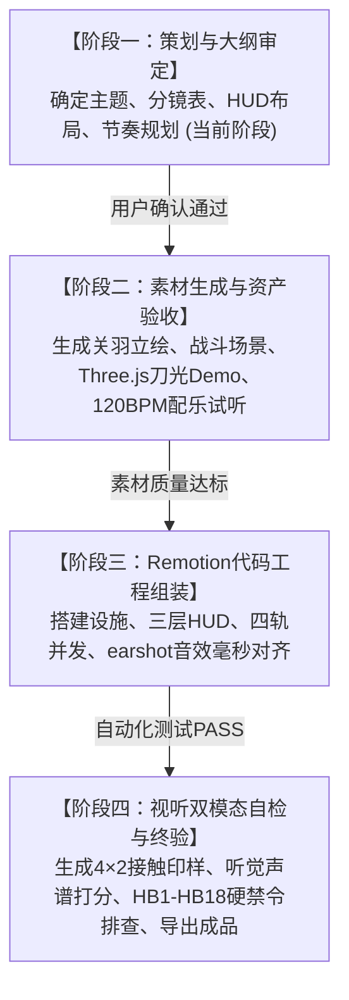

# 《三国志·武圣关羽》15秒游戏武将介绍视频：全案策划与技术执行总规划书

> **项目定位**：15 秒 AAA 级三国历史题材战争动作/策略游戏武将登场与实机介绍视频。  
> **设计哲学**：拒绝廉价 PPT 式相册轮播，严格落实 **高密度游戏 HUD 界面呈现、四轨并发交响编排、三维刀光粒子视觉冲击、纯代码物理音效与史诗战国 BGM 深度契合**。

---

## 一、 项目总览与技术规范 (Project Charter)

| 参数项 | 技术规格 | 规范说明 |
| :--- | :--- | :--- |
| **视频画幅** | 1920 × 1080 (16:9 横屏) | 标准主机/手游宣传片画幅，电影级宽屏视野 |
| **帧率基准** | 60.00 fps (刚性时钟) | 保证刀光挥砍与 UI 动效极致平滑，杜绝 30fps 卡顿感 |
| **视频总时长** | 15.000 秒 (整 900 帧) | 120 BPM 刚性节拍驱动（每拍 30 帧 = 0.500 秒，全片共 30 拍） |
| **色彩空间** | BT.709 / sRGB 电影级校色 | 沉浸式历史厚重感，青绿墨金与战火朱红对比 |
| **合成引擎** | **Remotion Tier-1 + WebGL Three.js** | 顶层以 Remotion 组织 60fps 轨道，内嵌 Three.js 3D 刀光粒子画布 |
| **声学母带** | **earshot v0.3.0 + 史诗游戏 BGM** | BS.1770 -14 LUFS 广播级标准，True Peak ≤ -1.5 dBTP |

---

## 二、 导演核心设计：M.O.T.I.O.N. 策划推演

针对此前复盘指出的“**视觉空洞、控件静态、缺乏转场连贯性、逆向颗粒度粗糙**”等核心问题，本案在导演层面设立专属防御机制：

### 1. M - Metaphor Made Literal (核心隐喻与贯穿信物)
- **核心隐喻**：【青龙破晓·一刀断江】。武圣关羽的登场绝非单调摆造型，而是“战阵前的不怒自威”到“万军之中的裂空斩杀”，体现“义绝天下、力拔千钧”的武圣之魂。
- **贯穿信物 (Carrier Object)**：**【青龙偃月刀的寒芒刀气 (Azure Dragon Blade Arc)】**。
  - 从第 1 帧的冰青色刀尖寒芒冷缩；
  - 贯穿为第二幕 UI 卡片边缘的高速雷达扫描光；
  - 在第三幕具象化为贯穿全屏的 3D 撕裂刀光；
  - 最终在第四幕收缩凝聚为蜀汉汉寿亭侯战印的金青色封边。

### 2. O - Optics & High-Density Game HUD (游戏界面布局与 70% 充实度)
坚决摒弃“单张人物立绘居中悬浮”的空洞设计，构建具备真实 AAA 游戏交互质感的 **三层空间复合 HUD**：

```
┌─────────────────────────────────────────────────────────────────────────────┐
│ TOP HUD: [阵营: 蜀汉] [神将级稀有度: SSR+]           [战斗力: 99,999 ▲]     │
├──────────────────────────────────────┬──────────────────────────────────────┤
│                                      │ RIGHT BENTO TELEMETRY (遥测数据区):  │
│                                      │ ┌──────────────────────────────────┐ │
│ MAIN STAGE (主舞台 65%):             │ │ 五维战神雷达图 (武力100/统率97)  │ │
│                                      │ ├──────────────────────────────────┤ │
│ [关羽 4K 动态立绘 / 砍杀战斗视窗]     │ │ 专属特性标签: [武圣] [威震华夏]  │ │
│ - 呼吸微动与披风粒子                 │ ├──────────────────────────────────┤ │
│ - 背景赤壁沙场硝烟视差               │ │ 实时怒气充能条: 100% [READY]     │ │
│ - 3D 青龙偃月刀光粒子实时交融        │ ├──────────────────────────────────┤ │
│                                      │ │ 战场指令: [青龙天翔·斩] (ACTIVE) │ │
│                                      │ └──────────────────────────────────┘ │
├──────────────────────────────────────┴──────────────────────────────────────┤
│ BOTTOM HUD: [武将全称: 汉寿亭侯·关云长] [HP血条/霸体槽] [COMBO x99 实时战损]│
└─────────────────────────────────────────────────────────────────────────────┘
```

- **充实度标准 (HB12 防御)**：主视觉区立绘与战斗视窗宽度占 65%，右侧游戏数据遥测面板宽度 ≥720px，四角布设仿古铜雀战印、铭文与实时跳动战场战损日志，全屏信息充实度稳定在 **75%–85%**。
- **控件内部实时微动 (HB13 防御)**：
  1. 战力数值计数器从 0 毫秒级飙升至 99,999；
  2. 怒气能量槽具有动态吞噬流动光晕；
  3. 五维雷达图六边形骨架从中心实时向外张开铺展；
  4. 技能图标具备“冷却完毕金光过载”微动。

### 3. T - Timing & 15秒分镜时钟表 (120 BPM 刚性节拍)
全片 15 秒（900 帧），以 120 BPM（每秒 2 拍，每拍 30 帧）严格编排四幕节奏：

```
时间轴 (0s - 15s / f0 - f900 @ 60fps, 120 BPM)
0s       2.0s        4.0s        7.0s        10.5s       12.5s       15.0s
|---------|-----------|-----------|-----------|-----------|-----------|
[Act 1: 神将降世]   [Act 2: 属性与战力爆发]   [Act 3: 沙场狂斩实机]   [Act 4: 锁定CTA]
 0f - 120f           120f - 420f             420f - 750f           750f - 900f
```

| 幕次 / 帧区间 | 剧情与画面描述 | 界面 UI 演进 | 视觉动势与转场 (Technique) | 音频与卡点 (earshot / BGM) |
| :--- | :--- | :--- | :--- | :--- |
| **Act 1: 神将降世**<br>f0 – f120<br>(0.0s – 2.0s) | 烽火沙场硝烟撕裂，青龙偃月刀自天际斜插地面，青色气浪震开！关羽巍然伫立，长髯飘拂。 | 游戏界面的四角青铜边框展开，顶部浮现 `[蜀汉·神将]` 印章，中央显示角色名【关羽·关云长】。 | **Laser Ingest + Shutter Reveal**：黑场被寒芒切开，立绘伴随冲击波切入，镜头向前急推 8%。 | **f0**: 沉重战鼓蓄势轰鸣<br>**f30**: 刀刃插地金属裂地音 (`metal_impact`)<br>**f60**: 战阵号角响起 |
| **Act 2: 战神遥测**<br>f120 – f420<br>(2.0s – 7.0s) | 镜头向左平移，关羽立绘转为战斗备战姿态；右侧展开游戏 HUD 属性面板。 | 1. 战力计数器狂飙至 `99,999`；<br>2. 五维雷达图向外激荡；<br>3. 专属词条【武圣】、【威震华夏】依次点亮；<br>4. 怒气条拉满并发出金色强光报警。 | **Swiss Bento Fold-Out + Cascade Entry**：遥测面板呈梯次级联展开，高亮线沿边缘游走，无死板等待。 | **f180**: 滚轮齿轮极速声 (`counter_roll`)<br>**f270**: 词条激活音 (`relay_click`)<br>**f360**: 满怒警报啸叫 (`energy_charge`) |
| **Act 3: 实机狂斩**<br>f420 – f750<br>(7.0s – 12.5s) | **战斗高潮**：UI 瞬间切换为**横版动作实机战斗模式**！关羽策马突入万军，挥舞青龙偃月刀横扫千军，随后切入奥义大招特写，3D青龙光刃撕裂全屏！ | 1. 屏幕右侧跳出实时 `COMBO x32 ... x99`；<br>2. 伤害数值 `CRITICAL 88,480` 暴击跳字；<br>3. 释放奥义【青龙偃月·斩】，全屏震颤。 | **Waterflow Slash + Camera Shake + Three.js 3D 粒子流**：刀光真实切割屏幕，慢动作定格（Hitstop 3帧）随后爆破。 | **f450**: 战马嘶鸣+马蹄疾奔<br>**f510**: 重斩破空呼啸 (`heavy_slash`)<br>**f600**: 暴击破甲音 (`armor_break`)<br>**f660**: 龙吟破晓咆哮 (`dragon_roar`) |
| **Act 4: 武圣定岳**<br>f750 – f900<br>(12.5s – 15.0s) | 刀光收束，关羽单手提刀背对苍生，披风在夕阳烽火中猎猎作响。画面呈现终局招募结算界面。 | 弹出【武圣降临·限时招募】CTA 按钮，蜀汉汉寿亭侯金印压印在右下角，提示“立即加入战场”。 | **Living Hold 微推**：全景以 1.03x 缓速向前推进，粒子微尘在余晖中浮动，绝无死锁定格。 | **f780**: 战印盖印沉重撞击 (`gated_impact`)<br>**f810**: 史诗交响大收尾和弦<br>**f900**: 极简金石尾音淡出 |

---

## 三、 素材生成与技术资产筹备方案 (Asset Production Plan)

为了实现高质量的视听质感，我们将按照以下清单精准生成与筹备素材：

### 1. 图像生成清单 (AI Image Prompts Architecture)

| 素材 ID | 类型 | 内容描述与风格 Prompt 要点 | 生成引擎与规格 |
| :--- | :--- | :--- | :--- |
| `img_guanyu_portrait` | 武将全景动态立绘 (主立绘) | **画面**：关羽傲然立于高台，头戴绿帻，身披鹦鹉绿罗袍与鱼鳞玄铁重铠，长髯飘拂胸前，丹凤眼、卧蚕眉，右手斜提青龙偃月刀，刀刃泛冷冽青光。<br>**风格**：AAA 三国动作游戏概念原画，光影厚重，写实材质，高细节纹理，4K 分辨率，Alpha 透明通道 PNG。 | GPT Image 2.5 / Midjourney<br>(3840×2160, RGBA) |
| `img_battle_slash` | 战场实机作战原画 (砍杀场景) | **画面**：关羽单骑冲入曹魏乱军大阵，跃马扬刀斜切劈砍，刀锋激荡起青色烈焰气浪，敌兵铠甲崩裂，黄沙漫天，硝烟弥漫。<br>**风格**：主机游戏战斗实机截图风格，动态模糊，电影级战争构图，张力拉满。 | GPT Image 2.5<br>(1920×1080) |
| `img_guanyu_cutin` | 奥义特写面部 (Skill Cut-in) | **画面**：关羽极近景特写，双目圆睁，眼神中透露出无可匹敌的武圣杀气，面如重枣，背景有青龙神魄咆哮显形。<br>**风格**：游戏觉醒大招过场特写，动漫与写实融合风格。 | GPT Image 2.5<br>(1920×1080) |
| `img_game_hud_kit` | 游戏古风 UI 套件 | **元素**：汉代青铜云纹边框、蜀汉龙纹血条槽、六边形古质罗盘雷达背景、汉寿亭侯朱砂印章、战力铭牌。 | 矢量重构 + 现代 UI 渲染 |

### 2. 视频/动态片段方案 (Combat Motion & 3D WebGL)

- **方案 A：AI 生成战斗实战微镜头**
  - 利用 Seedance / Kling 模型生成 2-3 秒“关羽大招力劈华山”的高帧率挥砍镜头，作为 Act 3 实机窗口的核心动态背景。
- **方案 B：Three.js 60fps 纯代码 3D 刀光粒子与气刃仿真 (Web-Sims / Canvas)**
  - 在 Remotion 内部挂载纯代码 WebGL Canvas：
    1. 构建一条由 5000+ 粒子组成的螺旋青龙能量轨迹（Azure Spiral Particles）；
    2. 刀光斩击时刻（f510, f660）实时通过贝塞尔曲线释放全屏扭曲 Shockwave 与 3D 几何光刃网格；
    3. 纯前端参数化控制，可精确到任意一帧（无任何外部视频抖动，完美锁定 60fps）。

### 3. BGM 音乐方案 (Epic Battle Soundtrack)

- **风格定位**：**《武圣·破阵曲》**——融合中国传统鼓阵（排鼓、大军鼓）、金戈铁马古琴/琵琶疾风骤雨扫弦，交织厚重的史诗铜管与战意重金属吉他。
- **制作方式**：
  - 节奏严格对准 **120 BPM**，4/4 拍，小节线精确锁定每 60 帧一个大重音；
  - Act 1 前奏肃杀（古筝琶音+号角）$\to$ Act 2 节奏切入（战鼓推进）$\to$ Act 3 狂暴高潮（双踩军鼓+管弦齐鸣+琵琶轮指）$\to$ Act 4 辉煌定岳（大钹齐响+交响大和弦）。

### 4. 音效方案 (earshot v0.3.0 + 纯代码声音套件)

利用最新发布的 `earshot v0.3.0` 初始化专项游戏音效套件 `audio/kit.json`：
- **挥击与破空**：`whoosh/blade_heavy`, `whoosh/laser`（提供青龙光刃的高频气流撕裂声）；
- **撞击与金石破甲**：`pro_impact/short`, `mechanical/relay_click`（刀兵相交的真实火花清脆声）；
- **能量与龙吟**：`chirp_data/rising` 变形调谐作为怒气充能声，底层混合低频气震 (`sub_bass`)；
- **UI 交互与打印**：`click_ui/crisp_tick`（数值飞滚音）、`metal_stamp`（战印盖下重音）。

---

## 四、 项目开发与交付流程 (Project Milestones)

我们严格遵循“**策划优先、分步验收、杜绝偷跑**”的项目管理流程：



---

## 五、 当前决策点与确认 (Confirmation Gate)

在启动后续的素材批量生成与代码工程前，请您对以下核心设计方向进行确认或调整：

1. **画面风格取向**：
   - **选项 A (推荐)**：**严肃写实暗黑硬派风**（沉稳黑金+冷翠青光+战地写实，类似《全面战争：三国》/《卧龙：苍天陨落》的厚重质感）。
   - **选项 B**：**新国潮国风幻想风**（明亮朱红+金光青龙+轻盈水墨笔触，偏向热血二次元与国潮卡牌风格）。
2. **战斗场景实现策略**：
   - 采用 **AI 生成战斗实战视频片段 + Three.js 3D 刀光粒子混合层叠**（具备影视级大招特写与代码级精准刀光）。
3. **分镜与节奏设计**：
   - 是否认可上述 15 秒（900 帧 / 120 BPM）的 **神将降世 $\to$ 属性遥测 $\to$ 战场狂斩 $\to$ 武圣定岳** 四段式推进架构？
