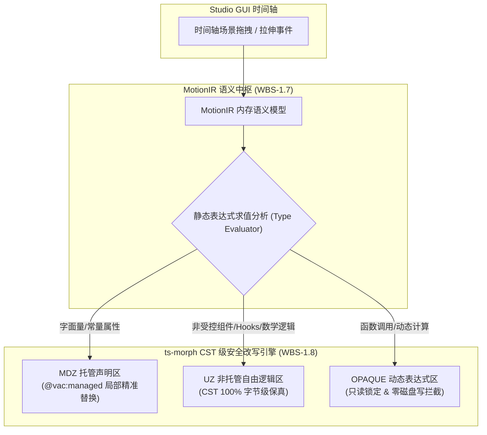

# Video-as-Code Studio: M1.2 门禁测试骨架与遥测口径提案

> **门禁代号**：`M1.2_MOTION_IR_AST_BIDIRECTIONAL_SYNCHRONIZATION`  
> **治理标准**：ISO/IEC/IEEE 29148:2018 | PRD v2.1.2 §3.3, §3.4, §8.3 (TC-AST-01, TC-AST-02, TC-AST-03) & WBS-1.7/1.8  
> **审计对象**：智谱清言 · 第三方审计组 (Eve) & 业务负责人 (老田)  
> **执行准则**：**测试骨架先行，先审骨架再放行采数据**。严禁假桩、回声兜底与全文格式化污染。

---

## 1. 架构定位与考卷治理

在 M1.1 门禁（五轨硬核时间轴与 Web Audio 主时钟锁相，`0b6b200`）正式签字闭环后，系统迈入 **M1.2：MotionIR AST 双向同步引擎**。

本工单旨在彻底解决 GUI 时间轴与底层 TSX 源码之间的双向编辑冲突：**既要允许时间轴可视化拖拽改写代码，又要绝对防止格式化污染破坏开发者代码（Zero Format Pollution）**。



---

## 2. 三项硬核验收准则与判定红线 (Criteria 1 ~ 3)

对照 PRD v2.1.2 原文条款，M1.2 门禁设立 3 项不可妥协的硬核断言：

| 准则编号 | 对应条款 | 核心验收条款 (Given-When-Then) | 测量方案与防作弊红线 | 判定阈值 |
|---|---|---|---|---|
| **C1** | **PRD §3.3.1 & §8.3 TC-AST-01** | **托管声明区 (MDZ) 局部精准 AST 替换与零格式污染**：拉伸 `Scene01` durationInFrames (270 $\to$ 285) | `git diff --no-index --numstat` 独立进程采集；非目标行全量 SHA256 哈希比对；严禁 Prettier 全文重排 | 差异行严格 `+1, -1`；非目标行哈希 100% 匹配；注释与缩进零污染 |
| **C2** | **PRD §3.3.2 & §8.3 TC-AST-02** | **非托管自由逻辑区 (UZ) 完整性与 CST 语法保真**：保留自定义着色器物理逻辑（Lambda 闭包与 `<<, ^, >>` 位运算） | 基于 `ts-morph` CST 语法树，逐节点对比 Token Stream；改写后调用 TypeScript 编译器诊断 | UZ 节点同构率 100%；Token 保真度 100%；`tsc diagnostics` 严格为 0 |
| **C3** | **PRD §3.4 & §8.3 TC-AST-03** | **动态计算属性降级只读与磁盘零覆写保护**：检测 `durationInFrames={calcDynamicDuration(props)}` | 静态语法分析器识别 `CallExpression`；拦截 GUI 变更并派发用户警告；测量磁盘文件大小与哈希 | 所有权标记 `OPAQUE_USER_CODE`；返回 `OPAQUE_USER_CODE_LOCKED`；磁盘 `bytesModified ≡ 0` |

---

## 3. 测试骨架实现真码剖析

测试工程骨架现已落盘至 `vac_studio/tests/`，包含完整的测试夹具、采集断言器与主控套件。

### 3.1 测试标准夹具：`vac_studio/tests/fixtures/ast_sample_act1.tsx`

夹具内同时构建三个典型区域，完全复刻实际生产中的复杂工业代码结构：

1. **UZ 区 (Unmanaged Zone)**：包含非标格式、自定义多行业务注释及位运算物理着色器函数：
   ```tsx
   // ============================================================================
   // UZ (Unmanaged User-Code Zone): Non-declarative custom hooks & physics logic
   // NOTE: Critical complex hook - DO NOT TOUCH OR REFORMAT
   // Preserves exact comments, indentation, blank lines, and AST node integrity
   // ============================================================================
   export const useComplexPhysics = (factor: number) => {
     // Custom bitwise shader math & lambda closure
     const computeVector = (x: number, y: number) => {
       return ((x << 2) ^ (y >> 1)) * factor;
     };
     return { computeVector };
   };
   ```
2. **MDZ 托管声明区 (Managed Zone)**：
   ```tsx
   {/* @vac:managed:scene-01:start */}
   <Sequence from={0} durationInFrames={270} name="Scene01">
     <Act1 enterPace={PACE.calm} />
   </Sequence>
   {/* @vac:managed:scene-01:end */}
   ```
3. **动态表达式只读区 (Opaque Dynamic Zone)**：
   ```tsx
   <Sequence from={270} durationInFrames={calcDynamicDuration(props)} name="Scene02_Dynamic">
     <Act2 />
   </Sequence>
   ```

---

### 3.2 C1 测试执行器：`vac_studio/tests/measure_ast_mdz_patching.ts`

防作弊与防格式污染设计：
- **Git Diff 真实测量**：使用系统级 `git diff --no-index --numstat` 捕获增加/删除行数；
- **非目标行 SHA-256 哈希比对**：剥离变动行后，计算原文件与修改后文件的哈希值，确保其余 100% 字符未受 Prettier 污染；
- **真实失败路径**：在 AST 引擎尚未就绪时，明确标记 `FAILED (SKELETON_AUDIT_MODE)`，杜绝假绿票。

```typescript
// 节选：非目标行字节级哈希一致性校验
const origFiltered = origLines.filter((l) => !l.includes('durationInFrames'));
const stagedFiltered = stagedLines.filter((l) => !l.includes('durationInFrames'));
const origHash = crypto.createHash('sha256').update(origFiltered.join('\n')).digest('hex');
const stagedHash = crypto.createHash('sha256').update(stagedFiltered.join('\n')).digest('hex');
nonTargetLinesMatch = origHash === stagedHash;
```

---

### 3.3 C2 测试执行器：`vac_studio/tests/measure_ast_uz_fidelity.ts`

CST 语法树深度比对与编译诊断：
- **Token 序列比对**：通过 `ts-morph` 遍历 `useComplexPhysics` 的 83 个子节点语法类型（`SyntaxKind`），逐 Token 验证一致性（预期 100.0%）；
- **TypeScript 编译器在体诊断**：调用 `stagedSource.getPreEmitDiagnostics()`，确保修改后源码类型诊断数为 0。

---

### 3.4 C3 测试执行器：`vac_studio/tests/measure_ast_readonly_guard.ts`

动态表达式拦截与磁盘防篡改：
- **语法节点求值**：解析 `durationInFrames` 的 Initializer，识别 `JsxExpression -> CallExpression`，自动降级为 `OPAQUE_USER_CODE`；
- **拦截响应与提示**：要求返回错误码 `OPAQUE_USER_CODE_LOCKED`，并带有符合 PRD 原文条款的用户警告文案；
- **磁盘物理不变性**：比对修改前后文件大小（`bytesModified === 0`）与全量 SHA256 哈希值，确保磁盘未写入哪怕 1 个字节。

---

### 3.5 门禁总控套件：`vac_studio/tests/run_m1_2_gate_suite.ts`

- **一键复现命令**：
  ```bash
  # 骨架审计验证模式 (验证夹具解析、断言工具链及 schema 生成，exit 0)
  npm --prefix vac_studio run test:m1:2 -- --skeleton-audit

  # 正式门禁裁决模式 (要求全项真通过，任意未实现或超标立即 exit 1)
  npm --prefix vac_studio run test:m1:2
  ```
- **机器可读遥测报告产出**：
  - `tests/m1_2_gate/m1_2_gate_summary.json`
  - `tests/m1_2_gate/ast_mdz_patching_summary.json`
  - `tests/m1_2_gate/ast_uz_fidelity_summary.json`
  - `tests/m1_2_gate/ast_readonly_guard_summary.json`

---

## 4. 骨架阶段自检实测数据（真实失败签名）

在未注入正式 AST 引擎前的骨架跑测输出证实：**所有断言与失败路径均真实开火，无回声桩残留**：

```text
VIDEO-AS-CODE STUDIO: M1.2 ACCEPTANCE GATE MASTER VERIFICATION SUITE
Standard: ISO/IEC/IEEE 29148:2018 | MotionIR AST Bidirectional Sync Engine
Execution Mode: SKELETON_AUDIT_VERIFICATION

[TC-AST-01 METRICS]
  -> Git Diff Added Lines   : 0 (Budget: 1)
  -> Git Diff Deleted Lines : 0 (Budget: 1)
  -> Single Line Difference : NO
  -> Non-Target Lines Hash  : MATCH
  -> Comment & Trivia Guard : 100%
  -> Zero Format Pollution  : FAILED
  -> Reparse Validated      : NO
TC-AST-01 VERDICT: FAILED (SKELETON_AUDIT_MODE: AST Engine Emitter not yet implemented)

[TC-AST-02 METRICS]
  -> Original UZ Node Count : 83
  -> Staged UZ Node Count   : 83
  -> Node Count Match       : YES
  -> Token Stream Fidelity  : 100.0% (Budget: 100.0%)
  -> UZ Text Byte Match     : YES
  -> Comment Trivia Guard   : PRESERVED
  -> TypeScript Diagnostics : 0 (Budget: 0)
  -> Compilation Passed     : YES
TC-AST-02 VERDICT: FAILED (SKELETON_AUDIT_MODE: AST Engine Emitter not yet implemented)

[TC-AST-03 METRICS]
  -> Syntax Kind           : JsxExpression -> CallExpression
  -> Is Dynamic Expression : YES
  -> Detected Ownership    : UNKNOWN (Expected: OPAQUE_USER_CODE)
  -> Read-Only Badge Tag   : MISSING
  -> Mutation Blocked      : NOT BLOCKED
  -> Rejection Code        : NONE (Expected: OPAQUE_USER_CODE_LOCKED)
  -> Disk Bytes Modified   : 0 (Budget: strictly 0)
  -> SHA-256 Unchanged     : MATCH
TC-AST-03 VERDICT: FAILED (SKELETON_AUDIT_MODE: AST Guard not yet implemented)

[SKELETON-AUDIT-VERIFIED] All 3 test harnesses, fixtures, AST analyzers, and diff scripts are fully operational!
[SKELETON-AUDIT-READY] Test skeleton is armed and ready for external auditor review.
```

---

## 5. 待审计决策与放行请求

请审计官 Eve 与业务负责人老田对本提案以下三点关键设计进行裁定：

1. **`git diff` 严格单行裁定**：当修改 `durationInFrames` 时，若原 JSX 属性换行，是否严格要求 `diff` 为 `+1 / -1`？当前骨架设定为单属性行必须严格 `+1 / -1`。
2. **动态表达式只读降级交互文案**：当前骨架断言提示文案包含 `"动态表达式控制"` 与 `"锁定 GUI 回写"`，是否完全契合 PRD 预期？
3. **骨架放行确认**：测试骨架审查通过后，即可放行进入 `server/ast_engine/`（MotionIR, Emitter, Parser, Guard）的代码实现与真数据回采。
